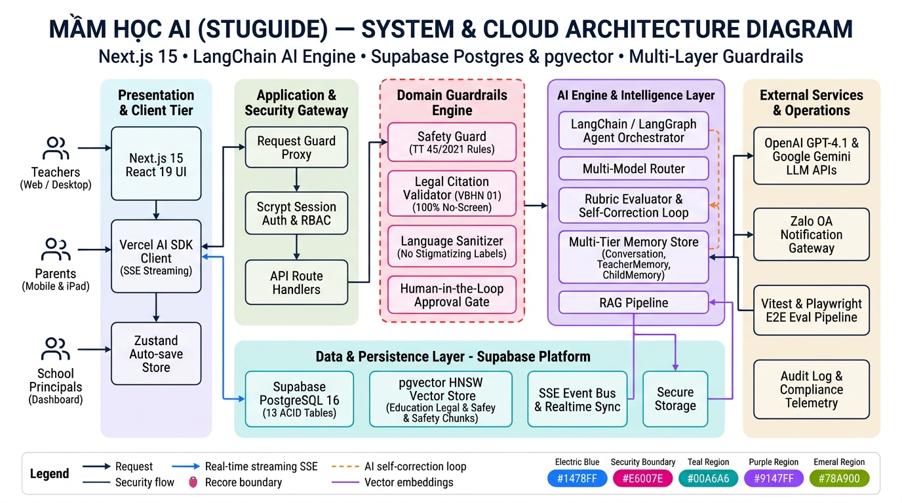

# 🌱 StuGuide — Trợ lý AI Giáo dục Mầm non

> **AI hỗ trợ người lớn – Trẻ học qua trải nghiệm thực tế (100% Screen-Free).**  
> Trợ lý AI giúp giáo viên mầm non soạn giáo án chuẩn Thông tư 45 & VBHN 01, kết nối phụ huynh và theo dõi phản hồi realtime.

---

## 🏛️ Kiến trúc Hệ thống (System Architecture)



### Điểm nhấn kỹ thuật
* **Presentation Tier:** Next.js 15 App Router + React 19, Vercel AI SDK (SSE streaming), Zustand tự lưu 500ms. Cổng phụ huynh iPad lưu phiên RAM (`ShortTermStore`) đồng bộ qua `sendBeacon`.
* **Security & Gateway:** Proxy bảo vệ nhiều lớp (chặn NUL/path traversal/CSRF), xác thực Scrypt + cookie HMAC, phân quyền nghiêm ngặt theo dữ liệu (BR-006).
* **Domain Guardrails Engine:** Bộ lọc bảo vệ độc lập trước và sau sinh:
  * `BR-001` (Human-in-the-loop): Mọi nội dung AI là `ai_draft`, chỉ phê duyệt/gửi qua nút bấm của người thật.
  * `BR-002` (An toàn TT 45/2021) & `BR-003` (Pháp lý VBHN 01 tra cứu qua RAG).
  * `BR-004` (Ngôn ngữ tích cực, cấm dán nhãn bệnh lý) & `BR-005` (100% Screen-Free cho trẻ).
* **AI Engine & Trí nhớ Đa tầng:** LangChain / LangGraph Agent, Rubrics đánh giá & tự sửa lỗi (Self-Correction Loop), quản lý trí nhớ dài hạn (`TeacherMemory`, `ChildMemory`, rolling summary).
* **Data & Persistence:** Supabase PostgreSQL 16 (13 bảng ACID), `pgvector` HNSW index (VBHN 01, TT 45, STEM, dân gian), Event Bus SSE & Realtime sync.

---

## 🚀 Chạy nhanh (Quick Start)

```bash
npm install
cp .env.example .env.local      # Bắt buộc điền OPENAI_API_KEY và SESSION_SECRET (≥ 32 ký tự)
npm run setup                   # prisma generate + sync schema Supabase + nạp dữ liệu demo
npm run dev                     # Chạy local tại http://localhost:3000
```

* **AI thật:** OpenAI (`gpt-4.1-2025-04-14` / `gpt-4.1-mini`) qua LangChain, pin theo snapshot. Khi lỗi 429/quota, chat tự fallback sang model nhanh và ghi log `llm_fallback`.
* **Đăng nhập:** Truy cập `/login` (mật khẩu chung: `stuguide`).

---

## 🧪 Kiểm thử (TDD)

```bash
npm test          # Vitest (nhanh, không tốn token API): guardrails, schema, RAG, services
npm run test:live # Vitest với OpenAI THẬT: kiểm tra tính sáng tạo, trí nhớ, rubric chấm điểm
npm run e2e       # Playwright E2E: 11 kịch bản đầy đủ 3 vai trò (cần E2E_DATABASE_URL trỏ tới một DB Postgres riêng — lệnh chạy sẽ force-reset DB đó)
npm run typecheck && npm run lint
```

---

## 📚 Tài liệu Chi tiết
* [Đặc tả nghiệp vụ (Spec 3.0)](docs/spec.md)
* [Kiến trúc kỹ thuật chi tiết (Architecture)](docs/architecture.md)
* [Sơ đồ Database & Luồng dữ liệu (Diagrams)](docs/diagram.md)
