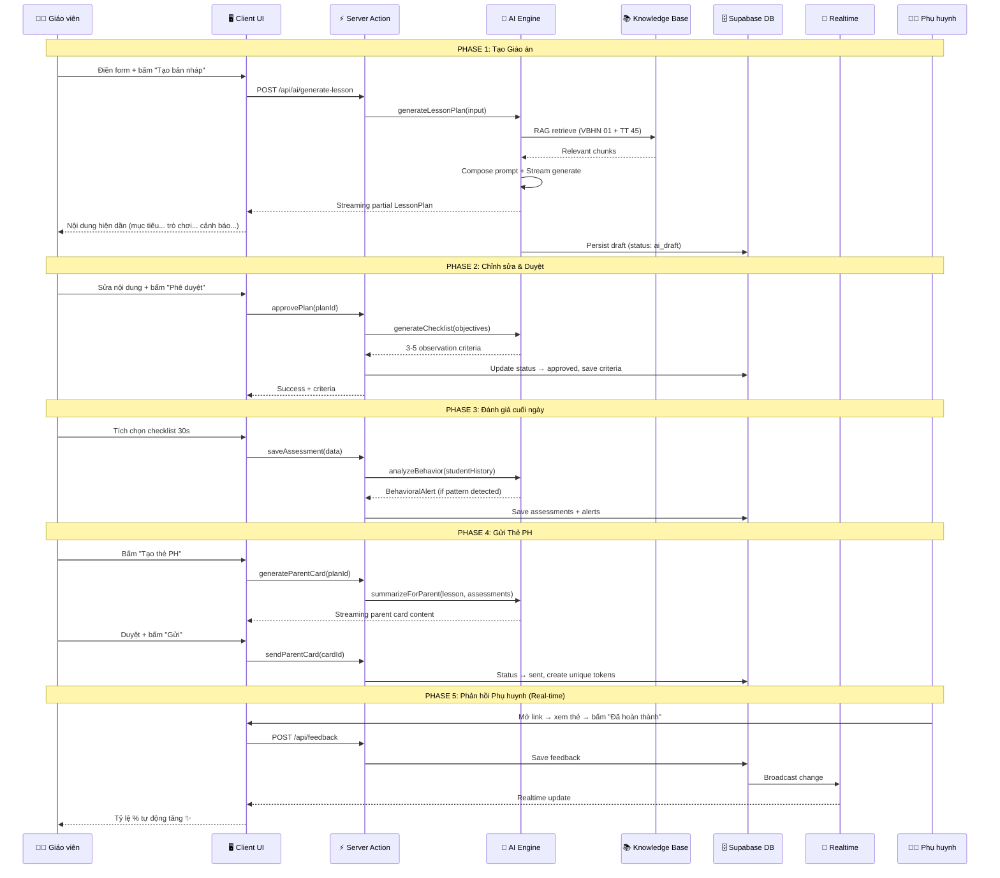

# 🧠 Mầm Học AI (StuGuide) — Kiến trúc AI-Native

## Tài liệu Kiến trúc Kỹ thuật

> **Phiên bản:** 1.0  
> **Ngày:** 2026-10-18  
> **Mục tiêu:** AI không phải feature — AI là nhân của app

---

## Mục lục

1. [Triết lý AI-Native](#1-triết-lý-ai-native)
2. [Technology Stack](#2-technology-stack)
3. [Kiến trúc tổng quan](#3-kiến-trúc-tổng-quan)
4. [Cấu trúc thư mục chi tiết](#4-cấu-trúc-thư-mục-chi-tiết)
5. [Layer Architecture — Chi tiết từng tầng](#5-layer-architecture--chi-tiết-từng-tầng)
6. [AI Engine — Thiết kế nhân AI](#6-ai-engine--thiết-kế-nhân-ai)
7. [RAG Pipeline — Kho tri thức](#7-rag-pipeline--kho-tri-thức)
8. [Luồng dữ liệu End-to-End](#8-luồng-dữ-liệu-end-to-end)
9. [Database Schema](#9-database-schema)
10. [Real-time & Streaming](#10-real-time--streaming)
11. [Prompt Engineering — Hệ thống Prompt](#11-prompt-engineering--hệ-thống-prompt)
12. [Tối ưu AI sáng tạo](#12-tối-ưu-ai-sáng-tạo)
13. [Testing Strategy](#13-testing-strategy)
14. [Deployment & Infrastructure](#14-deployment--infrastructure)

---

## 1. Triết lý AI-Native

### AI-Native khác gì AI-Bolted?

```
┌─────────────────────────────────────────────────────────────┐
│                    AI-BOLTED (Truyền thống)                  │
│                                                             │
│   App logic ──────────────────── UI                         │
│       │                                                     │
│       └── (gọi AI khi cần) ──── AI API                     │
│                                                             │
│   → AI là addon, gỡ ra app vẫn chạy                        │
└─────────────────────────────────────────────────────────────┘

┌─────────────────────────────────────────────────────────────┐
│                    AI-NATIVE (StuGuide)                      │
│                                                             │
│   UI ←── Streaming ←── AI Engine ←── Knowledge Base         │
│                            │                                │
│                       Domain Logic                          │
│                            │                                │
│                      Business Rules                         │
│                     (Guardrails Layer)                       │
│                                                             │
│   → AI là nhân, gỡ AI ra app không tồn tại                  │
│   → Mọi luồng chính đều đi qua AI Engine                    │
│   → Guardrails bao bọc AI, không phải ngược lại              │
└─────────────────────────────────────────────────────────────┘
```

### Nguyên tắc kiến trúc

| # | Nguyên tắc | Mô tả |
|---|-----------|-------|
| 1 | **AI-First Flow** | Mọi luồng nghiệp vụ chính (soạn giáo án, đánh giá, tóm tắt) đều khởi phát từ AI Engine. Không có luồng nào "gọi AI phụ". |
| 2 | **Streaming by Default** | Mọi output AI đều stream tới UI. Không đợi xong mới hiển thị. Người dùng thấy nội dung sinh ra realtime. |
| 3 | **Structured Output** | AI trả về JSON có schema cố định (Zod validation), không trả text tự do rồi parse. |
| 4 | **Guardrails as Middleware** | Quy tắc an toàn, pháp lý, đạo đức chạy như middleware — kiểm tra trước khi AI sinh, kiểm tra lại sau khi AI sinh. |
| 5 | **Knowledge-Grounded** | Mọi trích dẫn pháp lý đều RAG từ kho tri thức đã index. AI không bao giờ "sáng tác" số hiệu thông tư. |
| 6 | **Multi-Model Routing** | Dùng đúng model cho đúng task. Model sáng tạo cho giáo án, model nhanh cho tóm tắt, model phân tích cho behavioral analytics. |
| 7 | **Human-in-the-Loop** | AI luôn sinh bản nháp. Con người duyệt trước khi phát hành. Kiến trúc enforce điều này ở tầng domain. |
| 8 | **Prompt as Code** | Prompt được quản lý như source code — version control, template, variable injection, unit test. |

---

## 2. Technology Stack

### 2.1 Stack chính

| Tầng | Công nghệ | Phiên bản | Lý do chọn |
|------|-----------|-----------|-------------|
| **Framework** | Next.js (App Router) | 15+ | Server Components, Server Actions, Streaming SSR, API Routes — tất cả trong một. Tối ưu cho AI streaming. |
| **Language** | TypeScript | 5.5+ | Type safety cho structured output AI, Zod schema chia sẻ giữa prompt ↔ UI. |
| **Styling** | Tailwind CSS | 4+ | Utility-first, design token dễ customize, tương thích shadcn/ui. |
| **UI Library** | shadcn/ui | Latest | Unstyled primitives, copy-paste ownership, accessible, đẹp sẵn. Không phụ thuộc npm. |
| **Icons** | Lucide React | Latest | Nhẹ, tree-shakable, phong cách nhất quán. |
| **AI SDK** | Vercel AI SDK | 4+ | Unified interface cho multi-model (Gemini, Claude, OpenAI). Streaming, tool calling, structured output, generative UI. |
| **Primary AI Model** | Google Gemini 2.5 Pro | Latest | Long context (1M tokens), multimodal (text + image generation), sáng tạo mạnh, giá tốt, structured output native. |
| **Fast AI Model** | Google Gemini 2.5 Flash | Latest | Nhanh, rẻ, tốt cho tóm tắt, phân loại, extraction. |
| **Database** | PostgreSQL | 16+ | Relational + pgvector cho embeddings. Battle-tested. |
| **ORM** | Prisma | 6+ | Type-safe, migration, relation handling tốt. |
| **Vector Search** | pgvector extension | Latest | RAG search ngay trong PostgreSQL, không cần infra riêng. |
| **BaaS** | Supabase | Latest | Auth (OTP cho PH), Realtime (đồng bộ PH↔GV), Storage (học liệu), Database hosting. |
| **Validation** | Zod | 3+ | Schema validation chia sẻ giữa AI structured output ↔ form ↔ API ↔ DB. |
| **Charts** | Recharts | 2+ | React-native charting, đủ cho radar/pie/bar chart dashboard BGH. |
| **Form** | React Hook Form + Zod | Latest | Form validation type-safe, tích hợp Zod schema. |
| **State** | Zustand | 5+ | Lightweight, không boilerplate, selective re-render. |
| **Realtime** | Supabase Realtime | Latest | WebSocket cho đồng bộ phản hồi PH → GV tức thì. |
| **Print/PDF** | react-to-print + @react-pdf/renderer | Latest | In học liệu A4, xuất báo cáo kiểm định PDF. |
| **Testing** | Vitest + Testing Library + Playwright | Latest | Unit/Integration/E2E. |

### 2.2 Tại sao stack này tối ưu cho AI-Native?

```
┌─────────────────────────────────────────────────────────────────┐
│                                                                 │
│  Next.js Server Components                                      │
│  ┌──────────────────────────────────┐                           │
│  │ Server Action: generateLesson() │──── Chạy AI trên server   │
│  │ → Không leak API key            │     → Streaming về client  │
│  │ → Không CORS                    │     → Progressive render   │
│  │ → Edge/Node runtime             │                            │
│  └──────────────────────────────────┘                           │
│           │                                                     │
│           ▼                                                     │
│  Vercel AI SDK                                                  │
│  ┌──────────────────────────────────┐                           │
│  │ streamObject({                  │                            │
│  │   model: gemini('gemini-2.5-pro'),                          │
│  │   schema: lessonPlanSchema,     │ ← Zod schema              │
│  │   prompt: craftedPrompt,        │ ← Prompt template         │
│  │   temperature: 0.9,            │ ← Sáng tạo cao            │
│  │ })                              │                            │
│  └──────────────────────────────────┘                           │
│           │                                                     │
│           ▼                                                     │
│  Client: useObject() hook                                       │
│  ┌──────────────────────────────────┐                           │
│  │ Partial object streams in       │                            │
│  │ → UI renders từng phần          │                            │
│  │ → Không đợi xong mới hiển thị    │                            │
│  │ → UX mượt như ChatGPT           │                            │
│  └──────────────────────────────────┘                           │
│                                                                 │
└─────────────────────────────────────────────────────────────────┘
```

**Điểm mấu chốt:** Vercel AI SDK + Next.js Server Actions + Zod = pipeline AI type-safe, streaming, structured output — không cần viết boilerplate nào.

---

## 3. Kiến trúc tổng quan

### 3.1 High-Level Architecture

```
┌─────────────────────────────────────────────────────────────────────┐
│                         CLIENT (Browser)                            │
│                                                                     │
│  ┌───────────┐  ┌───────────┐  ┌──────────────┐  ┌──────────────┐  │
│  │ Teacher   │  │ Principal │  │   Parent     │  │  Shared      │  │
│  │ Pages     │  │ Pages     │  │   Pages      │  │  Components  │  │
│  └─────┬─────┘  └─────┬─────┘  └──────┬───────┘  └──────────────┘  │
│        │              │               │                             │
│        ▼              ▼               ▼                             │
│  ┌─────────────────────────────────────────────────────────────┐    │
│  │              React Hooks & Zustand Store                    │    │
│  │         useObject() · useChat() · useCompletion()           │    │
│  └─────────────────────────┬───────────────────────────────────┘    │
└────────────────────────────┼────────────────────────────────────────┘
                             │ HTTP Stream / WebSocket
┌────────────────────────────┼────────────────────────────────────────┐
│                    SERVER  │ (Next.js App Router)                    │
│                            ▼                                        │
│  ┌─────────────────────────────────────────────────────────────┐    │
│  │                   API / Server Actions                      │    │
│  │              (Route Handlers + Server Actions)              │    │
│  └─────────────────────────┬───────────────────────────────────┘    │
│                            │                                        │
│  ┌─────────────────────────▼───────────────────────────────────┐    │
│  │                 APPLICATION LAYER                            │    │
│  │           Use Cases / Service Orchestrators                  │    │
│  │    ┌────────────────┐ ┌────────────────┐ ┌───────────────┐  │    │
│  │    │ LessonPlanner  │ │ AssessmentSvc  │ │ ParentCardSvc │  │    │
│  │    └───────┬────────┘ └───────┬────────┘ └──────┬────────┘  │    │
│  └────────────┼──────────────────┼─────────────────┼───────────┘    │
│               │                  │                 │                │
│  ┌────────────▼──────────────────▼─────────────────▼───────────┐    │
│  │                   DOMAIN LAYER                               │    │
│  │         Business Rules / Guardrails / Validators             │    │
│  │    ┌──────────┐ ┌───────────┐ ┌──────────┐ ┌────────────┐  │    │
│  │    │ Safety   │ │ Legal     │ │ Language │ │ Permission │  │    │
│  │    │ Guard    │ │ Citation  │ │ Guard    │ │ Guard      │  │    │
│  │    │          │ │ Validator │ │ (No Diag)│ │            │  │    │
│  │    └──────────┘ └───────────┘ └──────────┘ └────────────┘  │    │
│  └─────────────────────────┬───────────────────────────────────┘    │
│                            │                                        │
│  ┌─────────────────────────▼───────────────────────────────────┐    │
│  │                    AI LAYER (Nhân hệ thống)                  │    │
│  │                                                              │    │
│  │  ┌──────────────────────────────────────────────────────┐   │    │
│  │  │              AI Engine (Orchestrator)                 │   │    │
│  │  │                                                      │   │    │
│  │  │  ┌──────────┐ ┌───────────┐ ┌──────────────────┐    │   │    │
│  │  │  │ Model    │ │ Prompt    │ │ Output           │    │   │    │
│  │  │  │ Router   │ │ Composer  │ │ Parser/Validator │    │   │    │
│  │  │  └──────────┘ └───────────┘ └──────────────────┘    │   │    │
│  │  │                                                      │   │    │
│  │  │  ┌──────────┐ ┌───────────┐ ┌──────────────────┐    │   │    │
│  │  │  │ RAG      │ │ Creative  │ │ Streaming        │    │   │    │
│  │  │  │ Pipeline │ │ Enhancer  │ │ Controller       │    │   │    │
│  │  │  └──────────┘ └───────────┘ └──────────────────┘    │   │    │
│  │  └──────────────────────────────────────────────────────┘   │    │
│  │                                                              │    │
│  │  ┌──────────────────────────────────────────────────────┐   │    │
│  │  │          Model Providers (via Vercel AI SDK)          │   │    │
│  │  │  ┌─────────────┐  ┌────────────┐  ┌──────────────┐  │   │    │
│  │  │  │ Gemini 2.5  │  │ Gemini 2.5 │  │ Gemini 2.5   │  │   │    │
│  │  │  │ Pro         │  │ Flash      │  │ Flash (Img)  │  │   │    │
│  │  │  │ (Creative)  │  │ (Fast)     │  │ (Visual)     │  │   │    │
│  │  │  └─────────────┘  └────────────┘  └──────────────┘  │   │    │
│  │  └──────────────────────────────────────────────────────┘   │    │
│  └─────────────────────────────────────────────────────────────┘    │
│                            │                                        │
│  ┌─────────────────────────▼───────────────────────────────────┐    │
│  │                 INFRASTRUCTURE LAYER                         │    │
│  │                                                              │    │
│  │  ┌──────────┐  ┌───────────┐  ┌──────────┐  ┌───────────┐  │    │
│  │  │ Supabase │  │ Supabase  │  │ Supabase │  │ Supabase  │  │    │
│  │  │ Postgres │  │ Auth      │  │ Storage  │  │ Realtime  │  │    │
│  │  │ +pgvector│  │ (OTP,JWT) │  │ (PDF,Img)│  │ (WS)     │  │    │
│  │  └──────────┘  └───────────┘  └──────────┘  └───────────┘  │    │
│  │                                                              │    │
│  │  ┌──────────────────────────────────────────────────────┐   │    │
│  │  │          Knowledge Base (pgvector embeddings)        │   │    │
│  │  │   VBHN 01 │ TT 45 │ Folklore │ STEM Activities      │   │    │
│  │  └──────────────────────────────────────────────────────┘   │    │
│  └─────────────────────────────────────────────────────────────┘    │
└─────────────────────────────────────────────────────────────────────┘
```

### 3.2 Luồng Request tiêu biểu: "Tạo Giáo án"

```
GV bấm "Tạo bản nháp bằng AI"
         │
         ▼
[1] Server Action: createLessonDraft(input)
         │
         ▼
[2] Application Layer: LessonPlannerService.generate(input)
         │
         ├──→ [3a] Domain Layer: validate input (required fields)
         │         └── SafetyGuard.precheck(materials, ageGroup)
         │
         ├──→ [3b] AI Layer: RAG Pipeline
         │         └── Embed query → pgvector search → top-K chunks
         │              (VBHN 01 objectives, TT 45 safety rules)
         │
         ├──→ [3c] AI Layer: Prompt Composer
         │         └── Assemble system prompt + context + user input
         │              + creativity directives + output schema
         │
         ├──→ [3d] AI Layer: Model Router
         │         └── Select Gemini 2.5 Pro (creative task)
         │              temperature: 0.9, topP: 0.95
         │
         ▼
[4] AI Layer: streamObject() — Streaming structured output
         │
         ├──→ [5a] Domain Layer: output guardrails (post-generation)
         │         ├── LanguageGuard.check(output) — no diagnostic terms
         │         ├── LegalCitationValidator.verify(output.legalRef)
         │         └── ScreenFreeGuard.check(output.activities)
         │
         ▼
[6] Stream partial LessonPlan object to client
         │
         ▼
[7] Client: useObject() renders progressively
         │
         ├── Mục tiêu bài học hiện ra...
         ├── Kịch bản trò chơi hiện ra...
         ├── Cảnh báo an toàn hiện ra...
         └── Flashcard mô tả hiện ra...
         │
         ▼
[8] Persist draft to Supabase (status: 'ai_draft')
```

---

## 4. Cấu trúc thư mục chi tiết

```
stuguide/
├── .env.local                          # API keys, Supabase URL
├── .env.example                        # Template cho dev mới
├── next.config.ts
├── tailwind.config.ts
├── tsconfig.json
├── prisma/
│   ├── schema.prisma                   # Database schema
│   └── migrations/                     # Migration history
│
├── src/
│   ├── app/                            # ═══ Next.js App Router ═══
│   │   ├── layout.tsx                  # Root layout (providers, fonts)
│   │   ├── page.tsx                    # Landing → redirect to /login
│   │   ├── globals.css                 # Tailwind imports + custom tokens
│   │   │
│   │   ├── (auth)/
│   │   │   ├── login/
│   │   │   │   └── page.tsx            # Màn hình 1: Login & Demo
│   │   │   └── layout.tsx              # Auth layout (centered card)
│   │   │
│   │   ├── (dashboard)/                # Authenticated layout group
│   │   │   ├── layout.tsx              # Sidebar + Header + RoleSwitcher
│   │   │   │
│   │   │   ├── teacher/
│   │   │   │   ├── page.tsx            # Màn hình 2: Dashboard GV
│   │   │   │   ├── create/
│   │   │   │   │   └── page.tsx        # Màn hình 3: Form tạo bài
│   │   │   │   ├── plan/[id]/
│   │   │   │   │   └── page.tsx        # Màn hình 4: Chi tiết giáo án
│   │   │   │   ├── assess/[planId]/
│   │   │   │   │   └── page.tsx        # Màn hình 5: Checklist 30s
│   │   │   │   └── parent-cards/
│   │   │   │       └── page.tsx        # Màn hình 6: Thẻ nhiệm vụ
│   │   │   │
│   │   │   └── principal/
│   │   │       └── page.tsx            # Màn hình 8: Dashboard BGH
│   │   │
│   │   ├── parent/                     # Public route (no auth sidebar)
│   │   │   └── [token]/
│   │   │       └── page.tsx            # Màn hình 7: Mobile PH
│   │   │
│   │   └── api/                        # API Route Handlers
│   │       ├── ai/
│   │       │   ├── generate-lesson/
│   │       │   │   └── route.ts        # POST: Stream giáo án
│   │       │   ├── generate-checklist/
│   │       │   │   └── route.ts        # POST: Sinh tiêu chí quan sát
│   │       │   ├── generate-parent-card/
│   │       │   │   └── route.ts        # POST: Tóm tắt thẻ PH
│   │       │   ├── analyze-behavior/
│   │       │   │   └── route.ts        # POST: Phân tích hành vi
│   │       │   └── regenerate-section/
│   │       │       └── route.ts        # POST: Viết lại 1 phần
│   │       ├── feedback/
│   │       │   └── route.ts            # POST: PH gửi phản hồi
│   │       └── export/
│   │           └── report/
│   │               └── route.ts        # GET: Xuất báo cáo PDF
│   │
│   ├── core/                           # ═══ DOMAIN LAYER ═══
│   │   ├── entities/                   # Domain entities (pure TS)
│   │   │   ├── lesson-plan.ts
│   │   │   ├── student.ts
│   │   │   ├── assessment.ts
│   │   │   ├── parent-card.ts
│   │   │   ├── behavioral-alert.ts
│   │   │   └── audit-log.ts
│   │   │
│   │   ├── schemas/                    # Zod schemas (shared AI ↔ UI ↔ DB)
│   │   │   ├── lesson-plan.schema.ts   # LessonPlan Zod schema
│   │   │   ├── assessment.schema.ts
│   │   │   ├── parent-card.schema.ts
│   │   │   ├── feedback.schema.ts
│   │   │   └── form-inputs.schema.ts   # Input form validation
│   │   │
│   │   ├── guardrails/                 # Business rule enforcement
│   │   │   ├── safety-guard.ts         # BR-002: Cảnh báo an toàn vật lý
│   │   │   ├── legal-citation.ts       # BR-003: Không trích dẫn giả
│   │   │   ├── language-guard.ts       # BR-004: Không chẩn đoán/dán nhãn
│   │   │   ├── screen-free-guard.ts    # BR-005: Không màn hình cho trẻ
│   │   │   ├── permission-guard.ts     # BR-006: Phân quyền dữ liệu trẻ
│   │   │   └── index.ts               # Compose all guards into pipeline
│   │   │
│   │   └── constants/
│   │       ├── age-groups.ts
│   │       ├── development-areas.ts
│   │       ├── materials.ts
│   │       └── status.ts
│   │
│   ├── ai/                             # ═══ AI LAYER (NHÂN HỆ THỐNG) ═══
│   │   ├── engine.ts                   # AI Engine orchestrator
│   │   ├── model-router.ts             # Multi-model routing
│   │   ├── prompt-composer.ts          # Prompt assembly + template
│   │   ├── creative-enhancer.ts        # Tăng cường sáng tạo
│   │   │
│   │   ├── prompts/                    # Prompt templates (version-controlled)
│   │   │   ├── lesson-planner.prompt.ts
│   │   │   ├── game-designer.prompt.ts
│   │   │   ├── checklist-generator.prompt.ts
│   │   │   ├── behavior-analyzer.prompt.ts
│   │   │   ├── parent-card-writer.prompt.ts
│   │   │   ├── section-rewriter.prompt.ts
│   │   │   └── _shared/
│   │   │       ├── system-identity.ts  # "Bạn là Mầm Học AI..."
│   │   │       ├── safety-rules.ts     # Safety instructions
│   │   │       └── language-rules.ts   # Vietnamese pedagogical tone
│   │   │
│   │   ├── rag/                        # RAG Pipeline
│   │   │   ├── embedder.ts             # Text → embedding vector
│   │   │   ├── retriever.ts            # pgvector similarity search
│   │   │   ├── chunker.ts              # Document chunking strategy
│   │   │   └── reranker.ts             # Re-rank retrieved chunks
│   │   │
│   │   ├── tools/                      # AI Tool definitions (function calling)
│   │   │   ├── search-legal-docs.ts    # Tool: tra cứu văn bản pháp lý
│   │   │   ├── check-safety-rules.ts   # Tool: kiểm tra an toàn vật liệu
│   │   │   ├── search-folk-games.ts    # Tool: tìm trò chơi dân gian
│   │   │   └── search-stem-activities.ts
│   │   │
│   │   └── output-guards/             # Post-generation validation
│   │       ├── citation-verifier.ts    # Verify trích dẫn vs KB
│   │       ├── banned-terms-filter.ts  # Filter từ ngữ cấm
│   │       └── schema-validator.ts     # Validate output vs Zod schema
│   │
│   ├── services/                       # ═══ APPLICATION LAYER ═══
│   │   ├── lesson-planner.service.ts   # Orchestrate lesson generation
│   │   ├── assessment.service.ts       # Checklist + behavioral analytics
│   │   ├── parent-card.service.ts      # Parent card generation + delivery
│   │   ├── feedback.service.ts         # Parent feedback processing
│   │   ├── report.service.ts           # BGH report generation
│   │   └── audit.service.ts            # Audit log recording
│   │
│   ├── data/                           # ═══ INFRASTRUCTURE LAYER ═══
│   │   ├── repositories/              # Data access (Prisma queries)
│   │   │   ├── lesson-plan.repo.ts
│   │   │   ├── student.repo.ts
│   │   │   ├── assessment.repo.ts
│   │   │   ├── parent-card.repo.ts
│   │   │   └── audit-log.repo.ts
│   │   │
│   │   ├── supabase/
│   │   │   ├── client.ts               # Supabase client init
│   │   │   ├── auth.ts                 # Auth helpers (login, OTP, session)
│   │   │   └── realtime.ts             # Realtime subscription helpers
│   │   │
│   │   └── knowledge-base/            # Kho tri thức (seed data)
│   │       ├── vbhn01/
│   │       │   ├── raw/                # Raw text documents
│   │       │   └── chunks.json         # Pre-chunked for embedding
│   │       ├── tt45-safety/
│   │       │   ├── raw/
│   │       │   └── rules.json          # Structured safety rules
│   │       ├── folklore/
│   │       │   └── games.json          # Trò chơi dân gian
│   │       └── stem/
│   │           └── activities.json     # Kịch bản STEM
│   │
│   ├── components/                     # ═══ PRESENTATION LAYER ═══
│   │   ├── ui/                         # shadcn/ui base components
│   │   │   ├── button.tsx
│   │   │   ├── card.tsx
│   │   │   ├── badge.tsx
│   │   │   ├── dialog.tsx
│   │   │   ├── input.tsx
│   │   │   ├── select.tsx
│   │   │   ├── textarea.tsx
│   │   │   ├── tabs.tsx
│   │   │   ├── toast.tsx
│   │   │   ├── skeleton.tsx
│   │   │   └── ... (shadcn components)
│   │   │
│   │   ├── shared/                     # App-specific shared components
│   │   │   ├── role-switcher.tsx
│   │   │   ├── status-badge.tsx
│   │   │   ├── safety-alert-box.tsx
│   │   │   ├── legal-reference-box.tsx
│   │   │   ├── ai-loading-stepper.tsx
│   │   │   ├── streaming-text.tsx      # Progressive text render
│   │   │   └── mobile-frame.tsx        # Wrapper cho giao diện PH
│   │   │
│   │   ├── teacher/
│   │   │   ├── lesson-plan-card.tsx
│   │   │   ├── create-plan-form.tsx
│   │   │   ├── plan-editor.tsx         # Inline editable sections
│   │   │   ├── flashcard-gallery.tsx
│   │   │   ├── checklist-table.tsx
│   │   │   ├── behavioral-alert.tsx
│   │   │   └── parent-feedback-stats.tsx
│   │   │
│   │   ├── parent/
│   │   │   ├── mission-card.tsx
│   │   │   ├── feedback-buttons.tsx
│   │   │   └── access-denied.tsx
│   │   │
│   │   └── principal/
│   │       ├── kpi-cards.tsx
│   │       ├── development-chart.tsx
│   │       ├── approval-table.tsx
│   │       └── audit-log-table.tsx
│   │
│   ├── hooks/                          # Custom React hooks
│   │   ├── use-ai-stream.ts            # Wrapper over useObject/useChat
│   │   ├── use-lesson-plan.ts
│   │   ├── use-assessment.ts
│   │   ├── use-realtime-feedback.ts    # Supabase realtime subscription
│   │   ├── use-auto-save.ts            # Debounced auto-save
│   │   └── use-auth.ts
│   │
│   ├── stores/                         # Zustand stores
│   │   ├── auth.store.ts
│   │   ├── lesson.store.ts
│   │   └── notification.store.ts
│   │
│   ├── lib/                            # Utilities
│   │   ├── utils.ts                    # cn(), formatDate(), etc.
│   │   ├── token.ts                    # URL token encode/decode (PH)
│   │   └── pdf.ts                      # PDF generation helpers
│   │
│   └── types/                          # Global TypeScript types
│       └── index.ts
│
├── scripts/
│   ├── seed-knowledge-base.ts          # Embed + index KB documents
│   ├── seed-mock-data.ts               # Seed demo data
│   └── test-prompts.ts                 # Prompt testing harness
│
├── tests/
│   ├── unit/
│   │   ├── guardrails/                 # Test business rules
│   │   │   ├── safety-guard.test.ts
│   │   │   ├── language-guard.test.ts
│   │   │   └── legal-citation.test.ts
│   │   ├── ai/
│   │   │   ├── prompt-composer.test.ts
│   │   │   ├── model-router.test.ts
│   │   │   └── output-guards.test.ts
│   │   └── services/
│   │       └── lesson-planner.test.ts
│   ├── integration/
│   │   ├── ai-pipeline.test.ts         # End-to-end AI flow
│   │   └── rag.test.ts                 # RAG retrieval accuracy
│   └── e2e/
│       ├── teacher-flow.spec.ts
│       ├── parent-flow.spec.ts
│       └── principal-flow.spec.ts
│
└── docs/
    ├── architecture.md                 # This document
    ├── prompt-guide.md                 # How to write/test prompts
    └── deployment.md                   # Deployment guide
```

---

## 5. Layer Architecture — Chi tiết từng tầng

### 5.1 Tổng quan 5 tầng

```
┌──────────────────────────────────────────────────┐
│  PRESENTATION    │  React Components + Hooks     │  src/app, components, hooks
│  (UI)            │  Server Components + Pages    │
├──────────────────┼───────────────────────────────┤
│  APPLICATION     │  Service Orchestrators        │  src/services
│  (Use Cases)     │  Server Actions coordination  │
├──────────────────┼───────────────────────────────┤
│  DOMAIN          │  Entities + Schemas           │  src/core
│  (Business)      │  Guardrails + Constants       │
├──────────────────┼───────────────────────────────┤
│  AI              │  Engine + Prompts + RAG       │  src/ai
│  (Intelligence)  │  Model Router + Tools         │
├──────────────────┼───────────────────────────────┤
│  INFRASTRUCTURE  │  Repositories + Supabase      │  src/data
│  (Data/IO)       │  Knowledge Base + Storage     │
└──────────────────┴───────────────────────────────┘
```

### 5.2 Dependency Rule

```
Presentation ──→ Application ──→ Domain ←── AI
                                   ↑           │
                                   │           │
                             Infrastructure ←──┘
```

- **Domain là trung tâm** — không phụ thuộc vào tầng nào.
- **AI Layer phụ thuộc Domain** — dùng schemas, guardrails, constants từ Domain.
- **Application orchestrate** — gọi AI Layer + Domain validation + Infrastructure persistence.
- **Presentation chỉ gọi Application** — thông qua Server Actions hoặc API routes.
- **Infrastructure implement interfaces** — nếu cần swap DB, chỉ đổi repositories.

### 5.3 Ví dụ code: Luồng qua từng tầng

#### Tầng Domain — Zod Schema (chia sẻ AI ↔ UI ↔ DB)

```typescript
// src/core/schemas/lesson-plan.schema.ts
import { z } from 'zod';

export const legalReferenceSchema = z.object({
  documentCode: z.string().describe('Số hiệu văn bản, VD: "VBHN 01/VBHN-BGDĐT"'),
  relevantSection: z.string().describe('Phần/điều khoản liên quan'),
  summary: z.string().describe('Tóm tắt nội dung áp dụng cho bài học này'),
  isVerified: z.boolean().describe('true nếu tìm thấy trong kho tri thức'),
});

export const safetyWarningSchema = z.object({
  level: z.enum(['critical', 'warning', 'info']),
  material: z.string().describe('Vật liệu hoặc hoạt động liên quan'),
  description: z.string().describe('Nội dung cảnh báo bằng tiếng Việt'),
  ageRestriction: z.string().nullable().describe('Giới hạn tuổi nếu có'),
});

export const procedureStepSchema = z.object({
  phase: z.enum(['warmup', 'main', 'cooldown']),
  title: z.string(),
  duration: z.number().describe('Thời lượng ước tính (phút)'),
  instructions: z.string().describe('Hướng dẫn chi tiết cho cô giáo'),
  teacherTip: z.string().describe('Mẹo xử lý tình huống sư phạm'),
});

// Schema này AI PHẢI trả về đúng cấu trúc — Vercel AI SDK enforce
export const lessonPlanOutputSchema = z.object({
  gameName: z.string().describe('Tên trò chơi/hoạt động sáng tạo, hấp dẫn'),
  legalReference: legalReferenceSchema,
  safetyWarnings: z.array(safetyWarningSchema).min(1),
  objectives: z.array(z.string()).min(2).max(5)
    .describe('Mục tiêu bài học, mỗi mục tiêu 1 câu'),
  preparation: z.array(z.string()).min(2)
    .describe('Danh sách đồ dùng chuẩn bị, Screen-Free'),
  procedure: z.array(procedureStepSchema).min(3)
    .describe('Tiến trình hoạt động: warmup → main → cooldown'),
  teacherScript: z.string()
    .describe('Lời dẫn mẫu gây hứng thú, giọng ấm áp, gần gũi trẻ 4-5 tuổi'),
  flashcardDescriptions: z.array(z.string()).min(2)
    .describe('Mô tả nội dung từng flashcard để sinh hình ảnh'),
  observationCriteria: z.array(z.string()).min(3).max(5)
    .describe('Tiêu chí hành vi quan sát cuối ngày, mỗi tiêu chí mô tả hành vi cụ thể'),
  eqQuestions: z.array(z.string()).min(2).max(3)
    .describe('Câu hỏi gợi mở EQ cho bố mẹ hỏi con buổi tối'),
});

export type LessonPlanOutput = z.infer<typeof lessonPlanOutputSchema>;
```

#### Tầng Domain — Guardrail

```typescript
// src/core/guardrails/language-guard.ts

const BANNED_TERMS = [
  'tự kỷ', 'tăng động', 'chậm phát triển', 'yếu kém',
  'bệnh lý', 'rối loạn', 'khuyết tật', 'bất thường',
  'thiểu năng', 'đần độn', 'ngu ngốc', 'kém cỏi',
];

export interface GuardResult {
  passed: boolean;
  violations: string[];
  sanitized?: string;
}

export function checkLanguage(text: string): GuardResult {
  const violations: string[] = [];
  let sanitized = text;

  for (const term of BANNED_TERMS) {
    if (text.toLowerCase().includes(term)) {
      violations.push(`Chứa từ ngữ cấm: "${term}"`);
      sanitized = sanitized.replace(
        new RegExp(term, 'gi'),
        '[cần quan tâm thêm]'
      );
    }
  }

  return {
    passed: violations.length === 0,
    violations,
    sanitized: violations.length > 0 ? sanitized : undefined,
  };
}
```

#### Tầng AI — Prompt Template

```typescript
// src/ai/prompts/lesson-planner.prompt.ts
import { systemIdentity } from './_shared/system-identity';
import { safetyRules } from './_shared/safety-rules';
import { languageRules } from './_shared/language-rules';
import type { CreatePlanInput } from '@/core/schemas/form-inputs.schema';

export function composeLessonPlannerPrompt(
  input: CreatePlanInput,
  ragContext: string,    // Retrieved knowledge base chunks
  safetyContext: string, // Retrieved safety rules
): string {
  return `
${systemIdentity}

${languageRules}

${safetyRules}

## NHIỆM VỤ
Bạn là chuyên gia soạn kế hoạch giáo dục mầm non. Hãy thiết kế một trò chơi/hoạt động giáo dục sáng tạo, hấp dẫn, dựa trên thông tin lớp học dưới đây.

## THÔNG TIN LỚP HỌC
- Độ tuổi: ${input.ageLabel}
- Mảng phát triển: ${input.developmentArea}
- Chủ đề: ${input.topic}
- Thời lượng: ${input.duration} phút
- Không gian: ${input.space === 'indoor' ? 'Trong lớp' : 'Ngoài sân'}
- Dụng cụ sẵn có: ${input.materials.join(', ')}
${input.stemEnabled ? '- ƯU TIÊN tích hợp định hướng STEM/STEAM' : ''}
${input.folkGameEnabled ? '- ƯU TIÊN lồng ghép trò chơi dân gian Việt Nam' : ''}
${input.classNotes ? `- Lưu ý đặc biệt: ${input.classNotes}` : ''}

## CĂN CỨ PHÁP LÝ (từ kho tri thức)
${ragContext}

## QUY TẮC AN TOÀN (từ kho tri thức)
${safetyContext}

## YÊU CẦU SÁNG TẠO
- Tên trò chơi phải GỢI CẢM, tạo hình ảnh sinh động trong đầu trẻ (VD: "Chuyến xe tình bạn", không phải "Trò chơi vận động số 1").
- Kịch bản phải có TÌNH HUỐNG BẤT NGỜ, yếu tố kịch tính nhẹ nhàng để trẻ hào hứng.
- Lời dẫn của cô giáo phải tự nhiên, ấm áp, như đang KỂ CHUYỆN cho trẻ nghe.
- Câu hỏi EQ phải MỞ, khuyến khích trẻ chia sẻ cảm xúc, KHÔNG hỏi đúng/sai.
- Dùng đồ vật sẵn có một cách SÁNG TẠO, bất ngờ (hộp sữa thành xe buýt, lá cây thành tiền, rổ thành cầu môn).
- TUYỆT ĐỐI mọi hoạt động phải là người thật – việc thật – đồ dùng thật. KHÔNG dùng màn hình.

## QUY TẮC TRÍCH DẪN
- Chỉ trích dẫn số hiệu văn bản có trong phần CĂN CỨ PHÁP LÝ ở trên.
- Nếu không tìm thấy căn cứ phù hợp, ghi rõ: isVerified = false.
- TUYỆT ĐỐI KHÔNG bịa ra số hiệu thông tư không có thật.
`.trim();
}
```

#### Tầng AI — Engine Orchestrator

```typescript
// src/ai/engine.ts
import { streamObject } from 'ai';
import { google } from '@ai-sdk/google';
import { routeModel } from './model-router';
import { composeLessonPlannerPrompt } from './prompts/lesson-planner.prompt';
import { retrieve } from './rag/retriever';
import { lessonPlanOutputSchema } from '@/core/schemas/lesson-plan.schema';
import { checkLanguage } from '@/core/guardrails/language-guard';
import { verifyCitation } from './output-guards/citation-verifier';
import type { CreatePlanInput } from '@/core/schemas/form-inputs.schema';

export async function generateLessonPlan(input: CreatePlanInput) {
  // 1. RAG: Retrieve relevant knowledge
  const legalChunks = await retrieve({
    query: `${input.developmentArea} ${input.ageGroup}`,
    collection: 'vbhn01',
    topK: 5,
  });

  const safetyChunks = await retrieve({
    query: input.materials.join(' '),
    collection: 'tt45-safety',
    topK: 3,
  });

  // 2. Compose prompt with context
  const prompt = composeLessonPlannerPrompt(
    input,
    legalChunks.map(c => c.content).join('\n'),
    safetyChunks.map(c => c.content).join('\n'),
  );

  // 3. Route to optimal model
  const model = routeModel('creative-generation');

  // 4. Stream structured output
  const result = streamObject({
    model,
    schema: lessonPlanOutputSchema,
    prompt,
    temperature: 0.9,         // Sáng tạo cao
    topP: 0.95,
    frequencyPenalty: 0.3,    // Giảm lặp từ
    maxTokens: 4096,
  });

  return result;
}
```

#### Tầng AI — Model Router

```typescript
// src/ai/model-router.ts
import { google } from '@ai-sdk/google';

type TaskType =
  | 'creative-generation'   // Soạn giáo án, trò chơi → Pro, temp cao
  | 'summarization'         // Tóm tắt thẻ PH → Flash, temp thấp
  | 'extraction'            // Sinh checklist, rút trích → Flash, temp thấp
  | 'analysis'              // Behavioral analytics → Pro, temp thấp
  | 'rewrite'               // Viết lại 1 section → Pro, temp trung bình
  | 'image-description';    // Mô tả flashcard → Flash, temp trung bình

interface ModelConfig {
  model: ReturnType<typeof google>;
  defaultTemperature: number;
  maxTokens: number;
}

const MODEL_CONFIGS: Record<TaskType, ModelConfig> = {
  'creative-generation': {
    model: google('gemini-2.5-pro-preview-06-05'),
    defaultTemperature: 0.9,
    maxTokens: 4096,
  },
  'summarization': {
    model: google('gemini-2.5-flash-preview-05-20'),
    defaultTemperature: 0.3,
    maxTokens: 1024,
  },
  'extraction': {
    model: google('gemini-2.5-flash-preview-05-20'),
    defaultTemperature: 0.2,
    maxTokens: 1024,
  },
  'analysis': {
    model: google('gemini-2.5-pro-preview-06-05'),
    defaultTemperature: 0.3,
    maxTokens: 2048,
  },
  'rewrite': {
    model: google('gemini-2.5-pro-preview-06-05'),
    defaultTemperature: 0.7,
    maxTokens: 2048,
  },
  'image-description': {
    model: google('gemini-2.5-flash-preview-05-20'),
    defaultTemperature: 0.5,
    maxTokens: 512,
  },
};

export function routeModel(task: TaskType) {
  return MODEL_CONFIGS[task].model;
}

export function getModelConfig(task: TaskType) {
  return MODEL_CONFIGS[task];
}
```

#### Tầng Application — Service

```typescript
// src/services/lesson-planner.service.ts
import { generateLessonPlan } from '@/ai/engine';
import { checkLanguage } from '@/core/guardrails/language-guard';
import { validateSafety } from '@/core/guardrails/safety-guard';
import { lessonPlanRepo } from '@/data/repositories/lesson-plan.repo';
import { auditService } from './audit.service';
import type { CreatePlanInput } from '@/core/schemas/form-inputs.schema';

export const lessonPlannerService = {
  async create(input: CreatePlanInput, userId: string) {
    // 1. Pre-generation validation
    validateSafety.precheck(input.materials, input.ageGroup);

    // 2. Generate via AI Engine (returns stream)
    const stream = await generateLessonPlan(input);

    // 3. Persist draft after stream completes
    stream.object.then(async (output) => {
      // Post-generation guardrails
      const langCheck = checkLanguage(JSON.stringify(output));
      if (!langCheck.passed) {
        // Log violation but still save (with sanitized version)
        await auditService.log({
          userId,
          action: 'ai_language_violation',
          details: langCheck.violations.join('; '),
        });
      }

      // Persist to database
      await lessonPlanRepo.create({
        ...input,
        ...output,
        status: 'ai_draft',
        teacherId: userId,
      });
    });

    // 4. Return stream immediately for progressive UI
    return stream;
  },

  async approve(planId: string, userId: string) {
    const plan = await lessonPlanRepo.findById(planId);
    if (!plan) throw new Error('Plan not found');

    await lessonPlanRepo.update(planId, {
      status: 'approved',
      approvedAt: new Date().toISOString(),
      approvedBy: userId,
    });

    await auditService.log({
      userId,
      action: 'approve_plan',
      target: planId,
    });
  },
};
```

#### Tầng Presentation — Server Action + Client Component

```typescript
// src/app/api/ai/generate-lesson/route.ts
import { lessonPlannerService } from '@/services/lesson-planner.service';
import { createPlanInputSchema } from '@/core/schemas/form-inputs.schema';

export async function POST(req: Request) {
  const body = await req.json();
  const input = createPlanInputSchema.parse(body);
  const userId = await getCurrentUserId(req);

  const result = await lessonPlannerService.create(input, userId);

  return result.toTextStreamResponse();
}
```

```tsx
// src/components/teacher/create-plan-form.tsx (Client Component)
'use client';

import { useObject } from '@ai-sdk/react';
import { lessonPlanOutputSchema } from '@/core/schemas/lesson-plan.schema';
import { StreamingLessonView } from './streaming-lesson-view';
import { AiLoadingStepper } from '@/components/shared/ai-loading-stepper';

export function CreatePlanForm() {
  const { object, submit, isLoading, error } = useObject({
    api: '/api/ai/generate-lesson',
    schema: lessonPlanOutputSchema,
  });

  return (
    <div>
      {/* Form inputs... */}

      <Button onClick={() => submit(formData)} disabled={isLoading}>
        ✨ Tạo bản nháp bằng AI
      </Button>

      {isLoading && <AiLoadingStepper current={object} />}

      {/* Partial object renders progressively as AI streams */}
      {object && (
        <StreamingLessonView
          plan={object}           // Partial — fields appear one by one
          isStreaming={isLoading}
        />
      )}

      {error && <ErrorFallback error={error} onRetry={() => submit(formData)} />}
    </div>
  );
}
```

---

## 6. AI Engine — Thiết kế nhân AI

### 6.1 Bản đồ AI Engine

```
                    ┌─────────────────────┐
                    │    AI ENGINE         │
                    │   (Orchestrator)     │
                    └────────┬────────────┘
                             │
              ┌──────────────┼──────────────┐
              │              │              │
              ▼              ▼              ▼
    ┌──────────────┐ ┌──────────────┐ ┌──────────────┐
    │   PRE-PHASE  │ │  GEN-PHASE   │ │  POST-PHASE  │
    │              │ │              │ │              │
    │ • Validate   │ │ • Route Model│ │ • Verify     │
    │   input      │ │ • Compose    │ │   citations  │
    │ • RAG        │ │   prompt     │ │ • Filter     │
    │   retrieve   │ │ • Stream     │ │   language   │
    │ • Safety     │ │   generate   │ │ • Schema     │
    │   precheck   │ │ • Apply      │ │   validate   │
    │              │ │   creativity │ │ • Persist    │
    │              │ │   enhancers  │ │              │
    └──────────────┘ └──────────────┘ └──────────────┘
```

### 6.2 AI Tool Calling (Function Calling)

Thay vì nhồi tất cả context vào prompt, AI có thể **tự gọi tool** để tra cứu:

```typescript
// src/ai/tools/search-legal-docs.ts
import { tool } from 'ai';
import { z } from 'zod';
import { retrieve } from '../rag/retriever';

export const searchLegalDocs = tool({
  description: 'Tra cứu văn bản pháp lý Bộ GD&ĐT trong kho tri thức. ' +
    'Dùng khi cần tìm mục tiêu phát triển, chuẩn đầu ra theo độ tuổi và mảng phát triển.',
  parameters: z.object({
    ageGroup: z.string().describe('Nhóm tuổi: "24-36m", "3-4y", "4-5y", "5-6y"'),
    developmentArea: z.string().describe('Mảng phát triển'),
    query: z.string().describe('Từ khóa tìm kiếm thêm'),
  }),
  execute: async ({ ageGroup, developmentArea, query }) => {
    const results = await retrieve({
      query: `${developmentArea} ${ageGroup} ${query}`,
      collection: 'vbhn01',
      topK: 5,
    });
    return results.map(r => ({
      documentCode: r.metadata.documentCode,
      section: r.metadata.section,
      content: r.content,
      similarity: r.similarity,
    }));
  },
});

// src/ai/tools/check-safety-rules.ts
export const checkSafetyRules = tool({
  description: 'Kiểm tra quy tắc an toàn vật lý theo Thông tư 45/2021 ' +
    'cho vật liệu và hoạt động cụ thể.',
  parameters: z.object({
    materials: z.array(z.string()).describe('Danh sách vật liệu sử dụng'),
    activities: z.array(z.string()).describe('Các hoạt động vận động'),
    ageGroup: z.string().describe('Nhóm tuổi'),
  }),
  execute: async ({ materials, activities, ageGroup }) => {
    const results = await retrieve({
      query: [...materials, ...activities].join(' '),
      collection: 'tt45-safety',
      topK: 5,
    });
    return results.map(r => ({
      level: r.metadata.level,
      description: r.content,
      ageRestriction: r.metadata.ageRestriction,
    }));
  },
});
```

Khi dùng với `streamObject`:

```typescript
const result = streamObject({
  model: google('gemini-2.5-pro-preview-06-05'),
  schema: lessonPlanOutputSchema,
  prompt: basePrompt,
  tools: {
    searchLegalDocs,
    checkSafetyRules,
    searchFolkGames,
    searchStemActivities,
  },
  maxSteps: 3, // Cho phép AI gọi tool tối đa 3 lần
});
```

→ AI sẽ **tự quyết định** khi nào cần tra cứu pháp lý, khi nào cần check an toàn — thay vì ta nhồi tất cả vào prompt.

---

## 7. RAG Pipeline — Kho tri thức

### 7.1 Kiến trúc RAG

```
┌─────────────────────────────────────────────────────────────┐
│                     INDEXING PHASE (1 lần)                    │
│                                                             │
│  Raw Documents ──→ Chunker ──→ Embedder ──→ pgvector Store  │
│  (VBHN 01, TT45)   (500 tokens)  (Gemini    (PostgreSQL)    │
│                     overlap 100    Embed)                    │
└─────────────────────────────────────────────────────────────┘

┌─────────────────────────────────────────────────────────────┐
│                    RETRIEVAL PHASE (mỗi request)             │
│                                                             │
│  User Input ──→ Query Embed ──→ Vector Search ──→ Re-rank  │
│  (tuổi, mảng,     (Gemini      (cosine sim     (MMR or     │
│   chủ đề)          Embed)       top-K=10)       cross-enc) │
│                                      │                      │
│                                      ▼                      │
│                                 Top-5 Chunks                │
│                                      │                      │
│                                      ▼                      │
│                              Inject into Prompt             │
└─────────────────────────────────────────────────────────────┘
```

### 7.2 Chunking Strategy cho văn bản pháp lý VN

```typescript
// src/ai/rag/chunker.ts

// Văn bản pháp lý VN có cấu trúc: Phần → Mục → Điều → Khoản → Điểm
// Chunk theo đơn vị ngữ nghĩa, không cắt ngang câu

interface Chunk {
  id: string;
  content: string;
  metadata: {
    documentCode: string;
    section: string;         // "Phần 3, Mục 2"
    ageGroup?: string;       // "4-5 tuổi"
    developmentArea?: string;// "Tình cảm & KNXH"
    chunkIndex: number;
  };
}

export function chunkLegalDocument(
  rawText: string,
  documentCode: string,
): Chunk[] {
  // Strategy: split by "Mục tiêu" / "Nội dung" / "Kết quả mong đợi"
  // headers, keeping parent section metadata
  // Target: ~500 tokens per chunk, 100 token overlap
  // ...
}
```

### 7.3 pgvector Schema

```sql
-- Prisma sẽ generate, đây là SQL tham khảo
CREATE EXTENSION IF NOT EXISTS vector;

CREATE TABLE knowledge_chunks (
  id UUID PRIMARY KEY DEFAULT gen_random_uuid(),
  collection VARCHAR(50) NOT NULL,     -- 'vbhn01', 'tt45-safety', 'folklore', 'stem'
  content TEXT NOT NULL,
  embedding vector(768),               -- Gemini embedding dimension
  metadata JSONB NOT NULL,
  created_at TIMESTAMPTZ DEFAULT NOW()
);

CREATE INDEX ON knowledge_chunks
  USING ivfflat (embedding vector_cosine_ops)
  WITH (lists = 100);
```

---

## 8. Luồng dữ liệu End-to-End

### 8.1 Flow: Tạo Giáo án → Đánh giá → Gửi PH → Nhận phản hồi



### 8.2 Real-time đồng bộ PH ↔ GV

```typescript
// src/hooks/use-realtime-feedback.ts
'use client';

import { useEffect, useState } from 'react';
import { createClient } from '@/data/supabase/client';
import type { ParentFeedback } from '@/core/schemas/feedback.schema';

export function useRealtimeFeedback(cardId: string) {
  const [feedbacks, setFeedbacks] = useState<ParentFeedback[]>([]);
  const supabase = createClient();

  useEffect(() => {
    // Initial fetch
    supabase
      .from('parent_feedbacks')
      .select('*')
      .eq('card_id', cardId)
      .then(({ data }) => setFeedbacks(data ?? []));

    // Realtime subscription
    const channel = supabase
      .channel(`feedback:${cardId}`)
      .on(
        'postgres_changes',
        {
          event: 'INSERT',
          schema: 'public',
          table: 'parent_feedbacks',
          filter: `card_id=eq.${cardId}`,
        },
        (payload) => {
          setFeedbacks(prev => [...prev, payload.new as ParentFeedback]);
        },
      )
      .subscribe();

    return () => { supabase.removeChannel(channel); };
  }, [cardId]);

  const completionRate = feedbacks.length > 0
    ? feedbacks.filter(f => f.response === 'completed').length / feedbacks.length
    : 0;

  return { feedbacks, completionRate };
}
```

---

## 9. Database Schema

### 9.1 Prisma Schema

```prisma
// prisma/schema.prisma

generator client {
  provider        = "prisma-client-js"
  previewFeatures = ["postgresqlExtensions"]
}

datasource db {
  provider   = "postgresql"
  url        = env("DATABASE_URL")
  extensions = [vector]
}

enum Role {
  teacher
  principal
  parent
}

enum PlanStatus {
  ai_draft
  needs_review
  approved
  shared
}

enum AssessmentRating {
  excellent
  achieved
  needs_practice
}

enum FeedbackResponse {
  completed
  needs_practice
}

model User {
  id          String   @id @default(uuid())
  fullName    String
  email       String?  @unique
  phone       String?  @unique
  role        Role
  schoolId    String
  createdAt   DateTime @default(now())

  school      School   @relation(fields: [schoolId], references: [id])
  classes     ClassTeacher[]
  lessonPlans LessonPlan[]
  feedbacks   ParentFeedback[]
  auditLogs   AuditLog[]

  linkedStudents StudentParent[]
}

model School {
  id      String  @id @default(uuid())
  name    String
  address String?

  users   User[]
  classes Class[]
}

model Class {
  id       String @id @default(uuid())
  name     String
  ageGroup String // '24-36m' | '3-4y' | '4-5y' | '5-6y'
  ageLabel String
  schoolId String

  school   School         @relation(fields: [schoolId], references: [id])
  teachers ClassTeacher[]
  students Student[]
  plans    LessonPlan[]
}

model ClassTeacher {
  classId   String
  teacherId String
  isPrimary Boolean @default(false)

  class   Class @relation(fields: [classId], references: [id])
  teacher User  @relation(fields: [teacherId], references: [id])

  @@id([classId, teacherId])
}

model Student {
  id           String   @id @default(uuid())
  fullName     String
  dateOfBirth  DateTime
  gender       String
  classId      String
  avatarEmoji  String?
  createdAt    DateTime @default(now())

  class        Class              @relation(fields: [classId], references: [id])
  parents      StudentParent[]
  assessments  StudentAssessment[]
  alerts       BehavioralAlert[]
  feedbacks    ParentFeedback[]
}

model StudentParent {
  studentId String
  parentId  String

  student Student @relation(fields: [studentId], references: [id])
  parent  User    @relation(fields: [parentId], references: [id])

  @@id([studentId, parentId])
}

model LessonPlan {
  id                String     @id @default(uuid())
  classId           String
  teacherId         String
  status            PlanStatus @default(ai_draft)
  createdAt         DateTime   @default(now())
  updatedAt         DateTime   @updatedAt
  approvedAt        DateTime?
  approvedBy        String?

  // Input
  ageGroup          String
  developmentArea   String
  stemEnabled       Boolean    @default(false)
  folkGameEnabled   Boolean    @default(false)
  topic             String
  duration          Int
  space             String
  materials         String[]
  classNotes        String?

  // Generated content (JSON)
  gameName          String?
  legalReference    Json?      // LegalReference
  safetyWarnings    Json?      // SafetyWarning[]
  objectives        String[]
  preparation       String[]
  procedure         Json?      // ProcedureStep[]
  teacherScript     String?
  flashcards        Json?      // Flashcard descriptions
  observationCriteria String[]

  class             Class            @relation(fields: [classId], references: [id])
  teacher           User             @relation(fields: [teacherId], references: [id])
  versions          PlanVersion[]
  checklists        ObservationChecklist[]
  parentCards       ParentCard[]
}

model PlanVersion {
  id                String   @id @default(uuid())
  planId            String
  versionNumber     Int
  editedBy          String
  editedAt          DateTime @default(now())
  sectionEdited     String
  changeDescription String
  previousContent   String   // Snapshot of changed section

  plan LessonPlan @relation(fields: [planId], references: [id])
}

model ObservationChecklist {
  id           String   @id @default(uuid())
  lessonPlanId String
  classId      String
  date         DateTime
  criteria     String[]
  savedAt      DateTime?

  lessonPlan   LessonPlan          @relation(fields: [lessonPlanId], references: [id])
  assessments  StudentAssessment[]
}

model StudentAssessment {
  id             String           @id @default(uuid())
  checklistId    String
  studentId      String
  overallRating  AssessmentRating
  ratings        Json             // Record<criterionIndex, rating>
  note           String?

  checklist ObservationChecklist @relation(fields: [checklistId], references: [id])
  student   Student              @relation(fields: [studentId], references: [id])
}

model BehavioralAlert {
  id                String   @id @default(uuid())
  studentId         String
  pattern           String
  weekCount         Int
  skillArea         String
  suggestedActivity String
  createdAt         DateTime @default(now())

  student Student @relation(fields: [studentId], references: [id])
}

model ParentCard {
  id               String   @id @default(uuid())
  lessonPlanId     String
  classId          String
  date             DateTime
  status           String   @default("draft") // 'draft' | 'sent'
  content          Json     // Full card content

  lessonPlan LessonPlan       @relation(fields: [lessonPlanId], references: [id])
  feedbacks  ParentFeedback[]
}

model ParentFeedback {
  id          String           @id @default(uuid())
  cardId      String
  studentId   String
  parentId    String
  response    FeedbackResponse
  message     String?
  respondedAt DateTime         @default(now())

  card    ParentCard @relation(fields: [cardId], references: [id])
  student Student    @relation(fields: [studentId], references: [id])
  parent  User       @relation(fields: [parentId], references: [id])

  @@unique([cardId, studentId]) // 1 phản hồi / bé / thẻ
}

model AuditLog {
  id        String   @id @default(uuid())
  userId    String
  action    String
  target    String?
  details   String?
  timestamp DateTime @default(now())

  user User @relation(fields: [userId], references: [id])
}

// Vector storage for RAG
model KnowledgeChunk {
  id         String   @id @default(uuid())
  collection String   // 'vbhn01', 'tt45-safety', 'folklore', 'stem'
  content    String
  embedding  Unsupported("vector(768)")
  metadata   Json
  createdAt  DateTime @default(now())
}
```

---

## 10. Real-time & Streaming

### 10.1 Ma trận Streaming

| Feature | Loại Stream | Công nghệ | Ghi chú |
|---------|------------|-----------|---------|
| Sinh giáo án | AI Object Stream | Vercel AI SDK `streamObject()` + `useObject()` | Partial object render progressively |
| Viết lại section | AI Text Stream | Vercel AI SDK `streamText()` + `useCompletion()` | Text appear word-by-word |
| Sinh thẻ PH | AI Object Stream | Vercel AI SDK `streamObject()` | Stream card content |
| Phản hồi PH → GV | Database Realtime | Supabase Realtime (WebSocket) | `postgres_changes` event |
| BGH duyệt → GV | Database Realtime | Supabase Realtime | Status change notification |
| Auto-save | Client → Server | Debounced POST (500ms) | Không cần stream |

---

## 11. Prompt Engineering — Hệ thống Prompt

### 11.1 Cấu trúc Prompt

```
┌─────────────────────────────────────────┐
│ SYSTEM IDENTITY                         │  Bạn là Mầm Học AI...
├─────────────────────────────────────────┤
│ LANGUAGE & TONE RULES                   │  Tiếng Việt, sư phạm, ấm áp
├─────────────────────────────────────────┤
│ SAFETY & ETHICAL RULES                  │  Guardrails cứng
├─────────────────────────────────────────┤
│ TASK DESCRIPTION                        │  Nhiệm vụ cụ thể
├─────────────────────────────────────────┤
│ USER CONTEXT                            │  Thông tin lớp học, vật liệu
├─────────────────────────────────────────┤
│ RETRIEVED KNOWLEDGE (RAG)               │  Chunks từ Knowledge Base
├─────────────────────────────────────────┤
│ CREATIVITY DIRECTIVES                   │  Yêu cầu sáng tạo cụ thể
├─────────────────────────────────────────┤
│ OUTPUT SCHEMA DESCRIPTION               │  Zod schema mô tả cho AI
├─────────────────────────────────────────┤
│ FEW-SHOT EXAMPLES (optional)            │  1-2 ví dụ output mẫu
└─────────────────────────────────────────┘
```

### 11.2 Prompt Version Management

```typescript
// src/ai/prompts/_shared/system-identity.ts

// Version: 2.1
// Last updated: 2026-10-18
// Author: Team StuGuide
// Changes: Thêm instruction về giọng kể chuyện

export const systemIdentity = `
Bạn là **Mầm Học AI** — trợ lý soạn giáo án và thiết kế trò chơi giáo dục mầm non Việt Nam.

Bạn đã được đào tạo trên toàn bộ Chương trình Giáo dục Mầm non quốc gia (VBHN 01/VBHN-BGDĐT)
và Thông tư 45/2021 về trường học an toàn.

## Bạn là ai:
- Một cô giáo mầm non giỏi nhất Việt Nam, 20 năm kinh nghiệm
- Sáng tạo, yêu trẻ, hiểu tâm lý trẻ sâu sắc
- Luôn nghĩ ra cách biến đồ vật đơn giản thành trò chơi kỳ diệu
- Kể chuyện hay, lôi cuốn, trẻ nghe là mê

## Bạn KHÔNG BAO GIỜ:
- Tạo hoạt động yêu cầu trẻ nhìn màn hình
- Chẩn đoán bệnh lý hay dán nhãn tâm lý cho trẻ
- Bịa số hiệu văn bản pháp lý không có thật
- Dùng ngôn ngữ lạnh lùng, kỹ thuật, xa cách
`.trim();
```

---

## 12. Tối ưu AI sáng tạo

### 12.1 Chiến lược sáng tạo theo từng task

| Task | Temperature | Top-P | Frequency Penalty | Creativity Techniques |
|------|-----------|-------|-------------------|----------------------|
| **Soạn giáo án & trò chơi** | `0.9` | `0.95` | `0.3` | Few-shot ví dụ sáng tạo; prompt yêu cầu "bất ngờ", "kỳ diệu"; persona "cô giáo 20 năm kinh nghiệm" |
| **Đặt tên trò chơi** | `1.0` | `0.98` | `0.5` | Yêu cầu tên gợi hình ảnh, kích thích trí tưởng tượng, dùng phép ẩn dụ |
| **Lời dẫn của cô giáo** | `0.9` | `0.95` | `0.3` | Persona "người kể chuyện", giọng ấm áp, tự nhiên, như nói với trẻ |
| **Câu hỏi EQ** | `0.85` | `0.9` | `0.4` | Câu hỏi mở, không đúng/sai, kích thích chia sẻ cảm xúc |
| **Tóm tắt thẻ PH** | `0.3` | `0.8` | `0.1` | Ngắn gọn, ấm áp nhưng chính xác, không sáng tạo quá |
| **Phân tích hành vi** | `0.2` | `0.7` | `0.0` | Khách quan, dựa trên dữ liệu, ngôn từ trung lập |

### 12.2 Creative Enhancer Module

```typescript
// src/ai/creative-enhancer.ts

// Kỹ thuật tăng cường sáng tạo trong prompt

export const creativityDirectives = {
  // Biến đồ vật thường thành phi thường
  objectTransformation: `
    Hãy nghĩ cách biến đồ vật bình thường thành thứ KỲ DIỆU trong mắt trẻ:
    - Hộp sữa → xe buýt, tòa lâu đài, robot, ống nhòm, điện thoại
    - Lá cây → tiền trong chợ, thuyền nhỏ, vé xe, thư gửi bạn
    - Rổ nhựa → cầu môn, hang động, mũ phi hành gia, tổ chim
    Hãy KHÔNG BAO GIỜ gọi đồ vật bằng tên thật trong trò chơi — luôn đặt tên mới.
  `,

  // Kịch bản có tính kể chuyện
  narrativeStructure: `
    Mỗi trò chơi phải có CÂU CHUYỆN nền:
    - MỞ ĐẦU: Một tình huống bất ngờ ("Ôi, các bạn thú trong rừng bị lạc rồi!")
    - THẮT NÚT: Thử thách ("Phải vượt qua 3 cửa ải để tìm đường về")
    - CAO TRÀO: Yếu tố cạnh tranh nhẹ hoặc hợp tác ("Hai đội cùng giúp nhau")
    - KẾT: Tất cả thắng, mọi người vui, nhấn mạnh giá trị (tình bạn, chia sẻ, kiên nhẫn)
  `,

  // Tích hợp văn hóa dân gian
  folkIntegration: `
    Khi tích hợp trò chơi dân gian, hãy:
    - Giữ nguyên luật chơi cốt lõi, thay đổi bối cảnh cho phù hợp chủ đề
    - Lồng ghép ca dao, đồng dao, vần điệu vào lời dẫn
    - VD: Trò "Mèo đuổi chuột" → thành "Mèo bưu tá đi giao thư tình bạn"
  `,

  // Tích hợp STEM sáng tạo
  stemIntegration: `
    STEM trong mầm non không phải công thức — mà là KHÁM PHÁ:
    - "Tại sao tháp hộp sữa đổ?" → Trọng lực, cân bằng
    - "Bóng lăn xa hơn trên sàn hay trên cỏ?" → Ma sát
    - "Nước đổ vào chai nào nhanh hơn?" → Thể tích
    Hãy đặt câu hỏi cho trẻ TỰ KHÁM PHÁ, không giảng giải.
  `,
};
```

### 12.3 Few-Shot Creative Examples (nạp vào prompt)

```typescript
// src/ai/prompts/_shared/creative-examples.ts

export const creativeExamples = `
## VÍ DỤ GIÁO ÁN SÁNG TẠO (để tham khảo phong cách)

### Ví dụ 1: "Chuyến xe tình bạn — Thu gom hộp sữa"
- Đồ vật bình thường: Hộp sữa, rổ nhựa, bóng nhỏ
- Biến thành: Xe buýt tình bạn, trạm đón khách, hành khách (bóng)
- Câu chuyện: "Xe buýt tình bạn sắp khởi hành! Nhưng có nhiều hành khách
  bị rơi xuống đường (bóng nhỏ). Hai đội tài xế phải nắm tay nhau,
  chạy thu gom hành khách vào xe (rổ) thật nhanh!"
- Yếu tố bất ngờ: Cô bấm chuông → "Trạm tiếp theo!", đội phải đổi vị trí
- Giá trị: Hợp tác, nắm tay bạn, kiên nhẫn xếp hàng

### Ví dụ 2: "Khu vườn bí ẩn — Khám phá lá cây"
- Đồ vật bình thường: Lá cây rụng, giấy A4, bút sáp
- Biến thành: Bản đồ kho báu (lá cây), giấy giải mã (frottage), chìa khóa
- Câu chuyện: "Cô vừa nhặt được những tấm bản đồ bí ẩn từ khu vườn cổ!
  Nhưng bản đồ bị mờ rồi. Các thám tử nhí hãy dùng bút sáp đặt lên bản đồ
  rồi tô nhẹ để hiện ra hoa văn bí mật (kỹ thuật frottage)!"
- Yếu tố STEM: Quan sát gân lá, so sánh hình dạng, phân loại
`;
```

---

## 13. Testing Strategy

### 13.1 Ma trận Testing

| Tầng | Loại Test | Công cụ | Ưu tiên | Ví dụ |
|------|----------|---------|---------|-------|
| **Guardrails** | Unit | Vitest | 🔴 Cao nhất | `language-guard` không để lọt "tự kỷ"; `safety-guard` detect "hạt nhỏ" + "24-36m" |
| **AI Output** | Integration | Vitest + AI SDK | 🔴 Cao | Output match Zod schema; trích dẫn pháp lý verified; không chứa banned terms |
| **Prompt Quality** | Eval | Custom harness | 🟡 Trung bình | 10 input variations → đánh giá creativity score, accuracy, tone |
| **RAG Retrieval** | Integration | Vitest | 🟡 Trung bình | Query "Tình cảm KNXH 4-5 tuổi" → top chunk chứa đúng mục tiêu VBHN 01 |
| **Services** | Unit | Vitest | 🟡 Trung bình | `lessonPlannerService.approve()` đổi status + ghi audit |
| **API Routes** | Integration | Vitest | 🟡 Trung bình | POST valid input → 200 stream; POST invalid → 400 |
| **UI Components** | Component | Testing Library | 🟢 Bình thường | Form validation, button states, badge colors |
| **E2E Flows** | E2E | Playwright | 🟢 Bình thường | GV tạo bài → duyệt → gửi PH → PH phản hồi → GV thấy % tăng |

### 13.2 AI Output Testing

```typescript
// tests/unit/ai/output-guards.test.ts
import { describe, it, expect } from 'vitest';
import { checkLanguage } from '@/core/guardrails/language-guard';

describe('LanguageGuard', () => {
  it('rejects diagnostic terms', () => {
    const result = checkLanguage('Bé có biểu hiện tự kỷ nhẹ');
    expect(result.passed).toBe(false);
    expect(result.violations).toContain('Chứa từ ngữ cấm: "tự kỷ"');
  });

  it('allows objective behavioral descriptions', () => {
    const result = checkLanguage(
      'Bé có biểu hiện ngại giao tiếp nhóm trong 3 tuần liên tiếp'
    );
    expect(result.passed).toBe(true);
  });

  it('sanitizes banned terms in output', () => {
    const result = checkLanguage('Trẻ tăng động cần được theo dõi');
    expect(result.sanitized).toBe('Trẻ [cần quan tâm thêm] cần được theo dõi');
  });
});
```

---

## 14. Deployment & Infrastructure

### 14.1 Deployment Architecture

```
┌──────────────────────────────────────────────────────┐
│                    Vercel                              │
│                                                      │
│  ┌────────────────────────────────────────────────┐  │
│  │ Next.js App (Edge + Node.js Runtime)           │  │
│  │ • Server Components (Edge)                     │  │
│  │ • API Routes /api/ai/* (Node.js — AI streaming)│  │
│  │ • Static assets (CDN)                          │  │
│  └────────────────────────────────────────────────┘  │
└──────────────────┬───────────────────────────────────┘
                   │
        ┌──────────┼──────────┐
        │          │          │
        ▼          ▼          ▼
┌──────────┐ ┌─────────┐ ┌─────────────┐
│ Supabase │ │ Google  │ │ Supabase    │
│ Postgres │ │ Gemini  │ │ Storage     │
│ +pgvector│ │ API     │ │ (PDF, img)  │
│ +Realtime│ │         │ │             │
└──────────┘ └─────────┘ └─────────────┘
```

### 14.2 Environment Variables

```env
# .env.local

# Supabase
NEXT_PUBLIC_SUPABASE_URL=https://xxx.supabase.co
NEXT_PUBLIC_SUPABASE_ANON_KEY=eyJhbG...
SUPABASE_SERVICE_ROLE_KEY=eyJhbG...    # Server-only

# Google Gemini
GOOGLE_GENERATIVE_AI_API_KEY=AIza...   # Server-only

# Database (Prisma)
DATABASE_URL=postgresql://...

# App
NEXT_PUBLIC_APP_URL=https://stuguide.vn
```

### 14.3 Chi phí ước tính (Monthly)

| Service | Tier | Chi phí ước tính | Ghi chú |
|---------|------|-----------------|---------|
| Vercel | Pro | ~$20/tháng | Hosting, CDN, Edge |
| Supabase | Pro | ~$25/tháng | DB, Auth, Realtime, Storage |
| Gemini API | Pay-per-use | ~$10–50/tháng | Phụ thuộc usage. Flash rẻ, Pro đắt hơn. |
| **Tổng** | | **~$55–95/tháng** | Rất hợp lý cho MVP |

---

> **Tài liệu này mô tả kiến trúc target. Triển khai theo từng phase:**
> - **Phase 1 (MVP):** Mock AI + localStorage → validate UX
> - **Phase 2:** Tích hợp Gemini API + Supabase → AI-Native thực sự
> - **Phase 3:** RAG pipeline + pgvector → Knowledge-grounded
> - **Phase 4:** Behavioral analytics + Realtime → Full features
