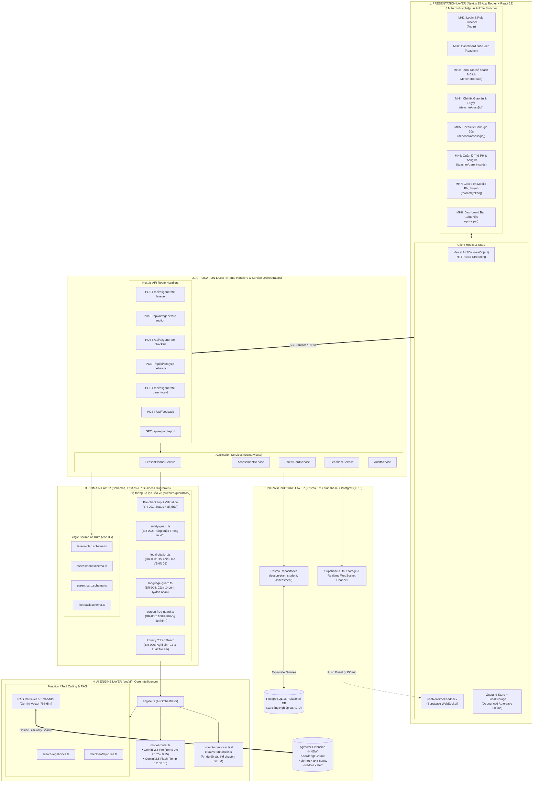
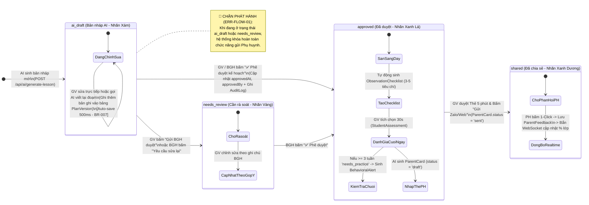
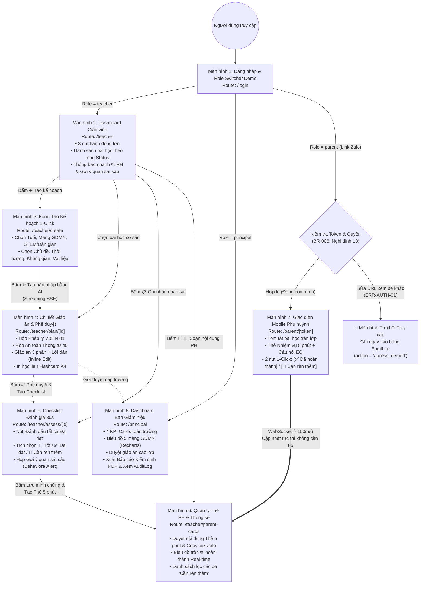
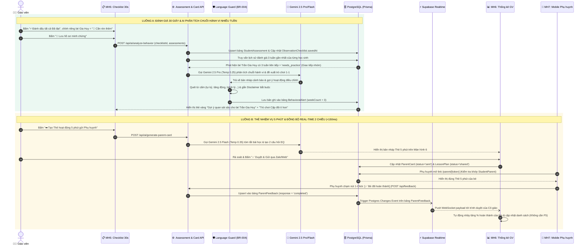

Bộ **6 sơ đồ kiến trúc kỹ thuật (Architecture & Database Diagrams)** cho dự án **Mầm Học AI (StuGuide)** được xây dựng dựa trên tài liệu đặc tả `spec.md` (Phiên bản 3.0 - AI-Native Unified Master Specification).

Toàn bộ sơ đồ được thiết kế bằng chuẩn **Mermaid.js** với đầy đủ tên bảng, kiểu dữ liệu, khóa chính (PK), khóa ngoại (FK), ràng buộc duy nhất (UK), cấu trúc JSON và luồng điều phối giữa Next.js 15, Vercel AI SDK, Gemini 2.5 Pro/Flash, Domain Guardrails và Supabase PostgreSQL (`pgvector`). Bạn có thể copy trực tiếp vào tài liệu kỹ thuật, Notion, GitHub hoặc trình tạo sơ đồ.

---

## 1. SƠ ĐỒ KIẾN TRÚC TỔNG THỂ HỆ THỐNG (5-LAYER AI-NATIVE ARCHITECTURE)

Sơ đồ này thể hiện cách 5 tầng kiến trúc (Presentation, Application, Domain Guardrails, AI Core, Infrastructure) liên kết một chiều và đặt **AI Engine** làm trung tâm điều phối nghiệp vụ.



---

## 2. SƠ ĐỒ CƠ SỞ DỮ LIỆU CHI TIẾT (PHYSICAL DATABASE SCHEMA & JSONB MAPPING)

Sơ đồ dưới đây phản ánh chính xác 100% toàn bộ **13 bảng (Models)**, **4 Enums**, các khóa chính (`PK`), khóa ngoại (`FK`), khóa duy nhất kết hợp (`UK`), kiểu mảng (`String[]`), cấu trúc nội tại của các cột `Json` và phần mở rộng `vector(768)` trong file `prisma/schema.prisma` của bạn.

```mermaid
erDiagram
    %% ==================== QUAN HỆ GIỮA CÁC BẢNG ====================
    School ||--o{ User : "1 trường có nhiều user (schoolId)"
    School ||--o{ Class : "1 trường có nhiều lớp (schoolId)"
    
    Class ||--o{ ClassTeacher : "phân công (classId)"
    User ||--o{ ClassTeacher : "đứng lớp (teacherId)"
    
    Class ||--o{ Student : "quản lý học sinh (classId)"
    Student ||--o{ StudentParent : "con của (studentId)"
    User ||--o{ StudentParent : "phụ huynh của (parentId)"
    
    Class ||--o{ LessonPlan : "triển khai tại (classId)"
    User ||--o{ LessonPlan : "soạn bởi GV (teacherId)"
    
    LessonPlan ||--o{ PlanVersion : "lưu vết sửa đổi (planId)"
    LessonPlan ||--o{ ObservationChecklist : "sinh tiêu chí (lessonPlanId)"
    LessonPlan ||--o{ ParentCard : "tóm tắt thành (lessonPlanId)"
    
    ObservationChecklist ||--o{ StudentAssessment : "ghi nhận (checklistId)"
    Student ||--o{ StudentAssessment : "được đánh giá (studentId)"
    
    Student ||--o{ BehavioralAlert : "cảnh báo chuỗi tuần (studentId)"
    
    ParentCard ||--o{ ParentFeedback : "nhận phản hồi (cardId)"
    Student ||--o{ ParentFeedback : "cho học sinh (studentId)"
    User ||--o{ ParentFeedback : "gửi bởi PH (parentId)"
    
    User ||--o{ AuditLog : "ghi vết bảo mật (userId)"

    %% ==================== CHI TIẾT TỪNG BẢNG ====================
    School {
        uuid id PK "default(uuid())"
        string name "Tên trường mầm non"
        string address "Nullable"
    }

    User {
        uuid id PK "default(uuid())"
        string fullName "Họ và tên"
        string email UK "Nullable, Unique"
        string phone UK "Nullable, Unique"
        enum role "ENUM: teacher | principal | parent"
        uuid schoolId FK "Ref -> School.id"
        datetime createdAt "default(now())"
    }

    Class {
        uuid id PK "default(uuid())"
        string name "VD: Lớp Mẫu giáo nhỡ B1"
        string ageGroup "24-36m | 3-4y | 4-5y | 5-6y"
        string ageLabel "VD: 4-5 tuổi"
        uuid schoolId FK "Ref -> School.id"
    }

    ClassTeacher {
        uuid classId PK,FK "Composite PK (classId, teacherId)"
        uuid teacherId PK,FK "Ref -> User.id"
        boolean isPrimary "default(false)"
    }

    Student {
        uuid id PK "default(uuid())"
        string fullName "Họ tên bé"
        datetime dateOfBirth "Ngày sinh"
        string gender "Giới tính"
        uuid classId FK "Ref -> Class.id"
        string avatarEmoji "default('👶')"
        datetime createdAt "default(now())"
    }

    StudentParent {
        uuid studentId PK,FK "Composite PK (studentId, parentId)"
        uuid parentId PK,FK "Ref -> User.id"
    }

    LessonPlan {
        uuid id PK "default(uuid())"
        uuid classId FK "Ref -> Class.id"
        uuid teacherId FK "Ref -> User.id"
        enum status "ENUM: ai_draft | needs_review | approved | shared"
        datetime createdAt "default(now())"
        datetime updatedAt "updatedAt"
        datetime approvedAt "Nullable"
        string approvedBy "Nullable"
        string ageGroup "Độ tuổi đầu vào"
        string developmentArea "1 trong 5 mảng GDMN"
        boolean stemEnabled "default(false)"
        boolean folkGameEnabled "default(false)"
        string topic "Chủ đề bài học"
        int duration "15 | 20 | 25 | 30 (phút)"
        string space "Trong lớp | Ngoài sân"
        string_array materials "String[] - Mảng vật liệu tái chế"
        string classNotes "Nullable"
        string gameName "Tên trò chơi AI sinh"
        jsonb legalReference "JSON: {documentCode, section, summary, isVerified}"
        jsonb safetyWarnings "JSON[]: [{level, material, description, ruleRef}]"
        string_array objectives "String[] - Mục tiêu 3 phần"
        string_array preparation "String[] - Đồ dùng 100% Screen-Free"
        jsonb procedure "JSON[]: [{phase, title, duration, instructions, teacherTip}]"
        string teacherScript "Lời dẫn mẫu truyền cảm hứng"
        string_array flashcardPrompts "String[] - Ý tưởng thẻ in ấn A4"
        string_array observationCriteria "String[] - 3-5 tiêu chí quan sát"
    }

    PlanVersion {
        uuid id PK "default(uuid())"
        uuid planId FK "Ref -> LessonPlan.id"
        int versionNumber "Số thứ tự phiên bản"
        string editedBy "Người sửa"
        datetime editedAt "default(now())"
        string sectionEdited "objectives | procedure | safety"
        string changeDescription "Mô tả thay đổi"
        string contentSnapshot "Bản lưu nội dung"
    }

    ObservationChecklist {
        uuid id PK "default(uuid())"
        uuid lessonPlanId FK "Ref -> LessonPlan.id"
        uuid classId "ID lớp học"
        datetime date "Ngày quan sát"
        string_array criteria "String[] - Danh sách tiêu chí"
        datetime savedAt "Nullable"
    }

    StudentAssessment {
        uuid id PK "default(uuid())"
        uuid checklistId FK,UK "Unique(checklistId, studentId)"
        uuid studentId FK,UK "Ref -> Student.id"
        enum overallRating "ENUM: excellent | achieved | needs_practice"
        jsonb ratings "JSON: Record<criterionIndex, AssessmentRating>"
        string note "Ghi chú khách quan (Nullable)"
    }

    BehavioralAlert {
        uuid id PK "default(uuid())"
        uuid studentId FK "Ref -> Student.id"
        string pattern "VD: Ngại giao tiếp nhóm"
        int weekCount "Số tuần lặp lại liên tiếp (>= 3)"
        string skillArea "Mảng kỹ năng"
        string suggestedActivity "Kịch bản trò chơi điều chỉnh 1-1"
        string disclaimer "default('Đây không phải chẩn đoán y khoa...')"
        datetime createdAt "default(now())"
    }

    ParentCard {
        uuid id PK "default(uuid())"
        uuid lessonPlanId FK "Ref -> LessonPlan.id"
        uuid classId "ID lớp học"
        datetime date "Ngày gửi"
        string status "draft | sent"
        jsonb content "JSON: {greeting, classSummary, missionTitle, duration, eqQuestions, adultRole}"
    }

    ParentFeedback {
        uuid id PK "default(uuid())"
        uuid cardId FK,UK "Unique(cardId, studentId)"
        uuid studentId FK,UK "Ref -> Student.id"
        uuid parentId FK "Ref -> User.id"
        enum response "ENUM: completed | needs_practice"
        string message "Lời nhắn của PH (Nullable)"
        datetime respondedAt "default(now())"
    }

    AuditLog {
        uuid id PK "default(uuid())"
        uuid userId FK "Ref -> User.id"
        string action "login | approve_plan | export_report | access_denied"
        string target "Đối tượng tác động (Nullable)"
        string details "Chi tiết log (Nullable)"
        datetime timestamp "default(now())"
    }

    KnowledgeChunk {
        uuid id PK "default(uuid()) - Bảng độc lập phục vụ RAG"
        string collection "INDEX: vbhn01 | tt45-safety | folklore | stem"
        string content "Nội dung điều khoản (~500 tokens)"
        vector_768 embedding "Unsupported('vector(768)') - HNSW Cosine Index"
        jsonb metadata "JSON: {source, page, ageGroup, article}"
        datetime createdAt "default(now())"
    }

```

---

## 3. SƠ ĐỒ PIPELINE AI ENGINE, MODEL ROUTER, RAG & GUARDRAILS

Sơ đồ này mô tả chi tiết luồng xử lý bên trong thư mục `src/ai/` và `src/core/guardrails/`, giải thích cách hệ thống kết hợp **RAG (`pgvector`)**, **Định tuyến mô hình (Model Router)** và **Bộ lọc an toàn 2 đầu (Pre-check & Post-check Guardrails)**.

```mermaid
flowchart LR
    %% INPUT
    Input["👩‍🏫 Input từ Giáo viên\n(Tuổi, Mảng GDMN, Chủ đề,\nVật liệu, STEM/Dân gian)"] --> PreGuard

    %% PRE-CHECK GUARDRAILS
    subgraph PreGuard ["Tầng 1: Pre-Check Guardrails"]
        V_Input["Kiểm tra đủ trường bắt buộc\n(ERR-INPUT-01)"]
        V_AgeMat["Kiểm tra chéo Tuổi x Vật liệu\n(VD: 24-36 tháng cảnh báo vật nhỏ)"]
        V_Input --> V_AgeMat
    end

    %% RAG PIPELINE
    PreGuard --> RAG_Step
    subgraph RAG_Step ["Tầng 2: RAG Pipeline (src/ai/rag/)"]
        Embed["embedder.ts\n(Gemini Embedding 768-dim)"]
        VecDB[("KnowledgeChunk\n(pgvector HNSW)")]
        TopK["retriever.ts (Cosine Similarity)\n• Top-5 đoạn VBHN 01/VBHN-BGDĐT\n• Top-3 quy tắc an toàn TT 45/2021\n• Gợi ý Đồng dao / STEM"]
        Embed --> VecDB --> TopK
    end

    %% PROMPT COMPOSER & CREATIVE ENHANCER
    RAG_Step --> Composer
    subgraph Composer ["Tầng 3: Prompt as Code (src/ai/prompts/)"]
        SysID["SYSTEM_IDENTITY\n(Cố vấn Sư phạm 20 năm, Screen-Free)"]
        Creative["creative-enhancer.ts\n1. Ẩn dụ đồ vật (Hộp sữa -> Xe buýt)\n2. Kể chuyện nhập vai (Storytelling)\n3. Tích hợp STEM & Dân gian"]
        SysID --> Creative
    end

    %% MODEL ROUTER
    Composer --> Router
    subgraph Router ["Tầng 4: Model Router (src/ai/model-router.ts)"]
        direction TB
        R_Pro1["Gemini 2.5 Pro (Temp: 0.90)\nSoạn Giáo án & Kịch bản Trò chơi"]
        R_Pro2["Gemini 2.5 Pro (Temp: 0.75)\nViết lại từng phần (Section Rewrite)"]
        R_Pro3["Gemini 2.5 Pro (Temp: 0.25)\nPhân tích Chuỗi Hành vi (>= 3 tuần)"]
        R_Flash1["Gemini 2.5 Flash (Temp: 0.20)\nRút trích 3-5 Tiêu chí Checklist"]
        R_Flash2["Gemini 2.5 Flash (Temp: 0.35)\nTóm tắt Thẻ Nhiệm vụ 5 Phút (<1s)"]
    end

    %% POST-CHECK GUARDRAILS
    Router --> PostGuard
    subgraph PostGuard ["Tầng 5: Post-Check Sanitizer & Zod Contract"]
        ZodParse["Zod Schema Enforcement\n(Output.object)"]
        G_BR002["BR-002: safety-guard.ts\n(Bắt buộc có khối safetyWarnings)"]
        G_BR003["BR-003: legal-citation.ts\n(Khớp mã văn bản VBHN 01)"]
        G_BR004["BR-004: language-guard.ts\n(Quét & xóa từ bệnh lý/tự kỷ/tăng động)"]
        G_BR005["BR-005: screen-free-guard.ts\n(Cấm thiết bị điện tử cho trẻ)"]
        ZodParse --> G_BR002 --> G_BR003 --> G_BR004 --> G_BR005
    end

    %% OUTPUT
    PostGuard --> StreamOut["⚡ HTTP SSE Stream (useObject)\nLưu DB với status = 'ai_draft' (BR-001)"]

```



---

## 4. SƠ ĐỒ MÁY TRẠNG THÁI VÒNG ĐỜI BÀI HỌC & KIỂM SOÁT QUYỀN (STATE MACHINE)

Sơ đồ này đảm bảo quy tắc **Human-in-the-Loop (BR-001)**: Mọi dữ liệu AI sinh ra không bao giờ được tự động gửi tới phụ huynh nếu chưa qua bước phê duyệt của con người.



---

## 5. SƠ ĐỒ ĐIỀU HƯỚNG 8 MÀN HÌNH & KIỂM SOÁT TRUY CẬP (RBAC & NAVIGATION MAP)

Sơ đồ này thể hiện luồng di chuyển giữa 8 màn hình trong Next.js App Router và cơ chế chặn truy cập trái phép theo **Nghị định 13/2023/NĐ-CP (BR-006)**.



---

## 6. SƠ ĐỒ TUẦN TỰ XỬ LÝ LỖI, PHÂN TÍCH HÀNH VI 3 TUẦN & ĐỒNG BỘ REALTIME

Sơ đồ Sequence này làm rõ 2 luồng kỹ thuật phức tạp nhất trong bản đặc tả của bạn: **Thuật toán phát hiện chuỗi hành vi lặp lại 3 tuần (AI Behavioral Analytics)** và **Đồng bộ phản hồi thời gian thực qua Supabase WebSocket**.



