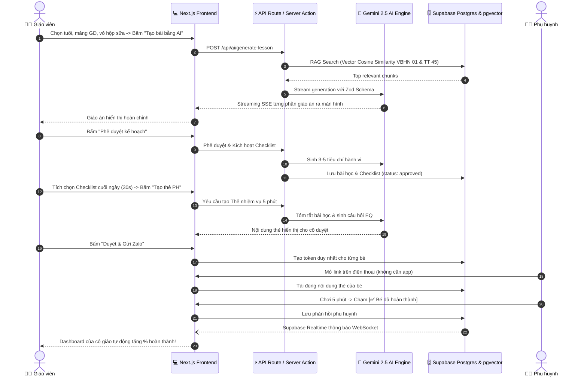

# 🌱 MẦM HỌC AI (STUGUIDE)
## TÀI LIỆU ĐẶC TẢ YÊU CẦU & KIẾN TRÚC HỆ THỐNG AI-NATIVE (MASTER SPECIFICATION)

> **Phiên bản:** 3.0 (AI-Native Unified Master Specification)  
> **Ngày cập nhật:** 2026-10-18  
> **Trạng thái:** Chính thức – Sẵn sàng phát triển & Vibe Coding  
> **Định vị sản phẩm:** Nền tảng Trợ lý AI Chuyên biệt cho Giáo dục Mầm non Việt Nam  

---

## 📑 MỤC LỤC

1. [Tổng quan dự án & Triết lý AI-Native](#1-tổng-quan-dự-án--triết-lý-ai-native)
2. [Đối tượng sử dụng & Chân dung người dùng (Personas)](#2-đối-tượng-sử-dụng--chân-dung-người-dùng-personas)
3. [Kiến trúc Kỹ thuật AI-Native Tổng thể](#3-kiến-trúc-kỹ-thuật-ai-native-tổng-thể)
4. [Cấu trúc Thư mục Clean Code](#4-cấu-trúc-thư-mục-clean-code)
5. [Thiết kế 5 Tầng Kiến trúc (Layered Architecture)](#5-thiết-kế-5-tầng-kiến-trúc-layered-architecture)
6. [Nhân AI (AI Engine) & Tối ưu Năng lực Sáng tạo](#6-nhân-ai-ai-engine--tối-ưu-năng-lực-sáng-tạo)
7. [Kho Tri thức Pháp lý & Pipeline RAG](#7-kho-tri-thức-pháp-lý--pipeline-rag)
8. [Mô hình Dữ liệu & Prisma Schema Hoàn chỉnh](#8-mô-hình-dữ-liệu--prisma-schema-hoàn-chỉnh)
9. [Đặc tả Chi tiết 8 Màn hình Ứng dụng](#9-đặc-tả-chi-tiết-8-màn-hình-ứng-dụng)
10. [Ma trận Tương tác Người dùng & Đồng bộ Real-time](#10-ma-trận-tương-tác-người-dùng--đồng-bộ-real-time)
11. [Quy tắc Nghiệp vụ & Hệ thống Bộ lọc Bảo vệ (Guardrails)](#11-quy-tắc-nghiệp-vụ--hệ-thống-bộ-lọc-bảo-vệ-guardrails)
12. [Hệ thống Prompt as Code & Kỹ thuật Sư phạm Sáng tạo](#12-hệ-thống-prompt-as-code--kỹ-thuật-sư-phạm-sáng-tạo)
13. [Ma trận Phân quyền Truy cập (RBAC)](#13-ma-trận-phân-quyền-truy-cập-rbac)
14. [Xử lý Ngoại lệ, Bảo mật & Edge Cases](#14-xử-lý-ngoại-lệ-bảo-mật--edge-cases)
15. [Chiến lược Kiểm thử Toàn diện (Testing Strategy)](#15-chiến-lược-kiểm-thử-toàn-diện-testing-strategy)
16. [Tiêu chí Nghiệm thu Hệ thống (Acceptance Criteria)](#16-tiêu-chí-nghiệm-thu-hệ-thống-acceptance-criteria)
17. [Phạm vi Loại trừ ở Bản MVP (Out of Scope)](#17-phạm-vi-loại-trừ-ở-bản-mvp-out-of-scope)
18. [Bộ Dữ liệu Mẫu Khởi tạo Sẵn (Mock Data Seed)](#18-bộ-dữ-liệu-mẫu-khởi-tạo-sẵn-mock-data-seed)

---

## 1. TỔNG QUAN DỰ ÁN & TRIẾT LÝ AI-NATIVE

### 1.1 Tên sản phẩm & Khẩu hiệu
* **Tên ứng dụng:** Mầm Học AI (StuGuide)
* **Slogan định vị:** *“AI hỗ trợ người lớn – Trẻ học qua trải nghiệm thật (Screen-Free)”*

### 1.2 Ba bài toán cốt lõi
1. **Soạn Kế hoạch & Trò chơi Thực tế 1-Click (Lesson & Game Planner):** Giải phóng giáo viên khỏi áp lực hành chính giấy tờ, tạo kịch bản trò chơi sư phạm kích thích tư duy từ vật liệu tái chế sẵn có trong lớp, tự động trích xuất căn cứ pháp lý Bộ GD&ĐT và sinh cảnh báo an toàn vật lý theo Thông tư 45.
2. **Đánh giá Kỹ năng Nhanh 30 Giây & Cảnh báo Sớm (Quick Assessment & AI Behavioral Analytics):** Thay thế sổ sách đánh giá thủ công bằng checklist hành vi 3–5 tiêu chí tự sinh từ mục tiêu bài học; AI phát hiện chuỗi hành vi lặp lại qua nhiều tuần để đưa ra "Gợi ý quan sát sâu" (tuyệt đối không chẩn đoán y khoa).
3. **Vòng lặp Kết nối Gia đình Khép kín (5-Minute Parent Alignment):** Tự động tinh gọn bài học thành "Thẻ nhiệm vụ 5 phút" buổi tối kèm câu hỏi gợi mở trí tuệ cảm xúc (EQ); phụ huynh phản hồi 1-chạm (1-Click), kết quả tự động cập nhật thời gian thực về bảng điều khiển của cô giáo.

### 1.3 Triết lý AI-Native: AI là Nhân, Không phải Tiện ích gắn thêm
Trong ứng dụng AI-Native, mọi luồng nghiệp vụ cốt lõi đều được thiết kế xoay quanh trí tuệ nhân tạo:
* **Không phải "AI-Bolted":** Ở các app truyền thống, app chạy logic tĩnh rồi gọi API AI phụ trợ. Nếu ngắt AI, app vẫn chạy nhưng thiếu tính năng.
* **Là "AI-Native":** StuGuide đặt AI Engine vào trung tâm của Domain Logic. Toàn bộ chu trình từ khởi tạo giáo án, trích xuất pháp lý, kiểm duyệt an toàn, sinh checklist cho đến tóm tắt hoạt động cho phụ huynh đều do AI dẫn dắt và được bao bọc bởi hệ thống Guardrails chặt chẽ.

```
┌────────────────────────────────────────────────────────────────────────┐
│                   MÔ HÌNH KIẾN TRÚC AI-NATIVE STUGUIDE                 │
│                                                                        │
│   UI Layer (Streaming UX) <────────────────────────┐                  │
│             │                                      │                  │
│             ▼                                      │ Streaming SSE    │
│   Application Orchestrator                         │ (useObject)      │
│             │                                      │                  │
│             ▼                                      │                  │
│   Domain Guardrails (Pre-check)                    │                  │
│             │                                      │                  │
│             ▼                                      │                  │
│     ┌──────────────────────────────────────────────┴───────────┐      │
│     │                    AI ENGINE (CORE)                      │      │
│     │  • Model Router (Gemini 2.5 Pro / Flash)                 │      │
│     │  • Structured Outputs (Zod Schema Enforced)              │      │
│     │  • Function / Tool Calling (Legal & Safety Search)       │      │
│     │  • Pedagogy & Creativity Directives                      │      │
│     └──────────────────────────────┬───────────────────────────┘      │
│                                    │                                  │
│             ┌──────────────────────┴──────────────────────┐           │
│             ▼                                             ▼           │
│    RAG Knowledge Base                            Domain Guardrails    │
│    (PostgreSQL pgvector)                         (Post-check Sanitizer│
│    VBHN 01 | TT 45 | Dân gian & STEM             Cấm dán nhãn trẻ)   │
└────────────────────────────────────────────────────────────────────────┘
```

### 1.4 Nguyên tắc bất di bất dịch (Guiding Principles)
1. **100% Screen-Free cho trẻ mầm non:** Trẻ từ 1–6 tuổi tuyệt đối không tiếp xúc với màn hình điện thoại/máy tính hay trợ lý ảo giọng nói. Ứng dụng chỉ phục vụ người lớn (Giáo viên, BGH, Phụ huynh) để tổ chức hoạt động ngoài đời thực.
2. **Con người kiểm soát tối cao (Human-in-the-Loop):** AI luôn bắt đầu ở trạng thái bản nháp (`ai_draft`). Phải có sự rà soát và bấm nút phê duyệt của giáo viên thì nội dung mới được phép ban hành.
3. **Không tạo trích dẫn giả mạo (Grounded Knowledge):** Mọi điều khoản pháp lý đều phải truy xuất chính xác từ cơ sở dữ liệu đã kiểm định.
4. **Không kết luận bệnh lý hay dán nhãn trẻ:** Hệ thống chỉ ghi nhận hành vi quan sát khách quan, hỗ trợ cô giáo quan sát sâu, cấm sử dụng các thuật ngữ y khoa (tự kỷ, tăng động, chậm phát triển, v.v.).

---

## 2. ĐỐI TƯỢNG SỬ DỤNG & CHÂN DUNG NGƯỜI DÙNG (PERSONAS)

### 2.1 Ma trận Nhóm người dùng

| Nhóm người dùng | Thiết bị chính | Mục tiêu cốt lõi | Rào cản kỹ thuật |
| :--- | :--- | :--- | :--- |
| **1. Giáo viên mầm non** (Người dùng chính) | Laptop, Tablet, Mobile | Soạn giáo án sáng tạo, đánh giá nhanh, gửi tin phụ huynh | Ít thời gian, không rành kỹ thuật prompt AI |
| **2. Ban giám hiệu / Chủ trường** (Quản lý) | Desktop / Laptop | Kiểm duyệt giáo án, theo dõi chỉ số toàn trường, xuất kiểm định | Cần tổng quan nhanh, số liệu chính xác theo luật |
| **3. Phụ huynh học sinh** (Đối tác đồng hành) | Smartphone (Web/Zalo) | Biết con học gì, chơi với con 5 phút đúng cách, phản hồi nhanh | Bận rộn, không muốn cài thêm app cồng kềnh |
| **4. Trẻ mầm non 1–6 tuổi** (Thụ hưởng gián tiếp) | Không dùng thiết bị | Vui chơi vận động, phát triển cảm xúc và kỹ năng sống | Không tiếp xúc công nghệ số |
---

## 3. KIẾN TRÚC KỸ THUẬT AI-NATIVE TỔNG THỂ

### 3.1 Technology Stack Chuẩn Hiện đại

| Tầng chức năng | Công nghệ lựa chọn | Phiên bản | Lý do kỹ thuật |
| :--- | :--- | :--- | :--- |
| **Web Framework** | **Next.js (App Router)** | `15.x` | React 19, Server Components, Route Handlers tối ưu HTTP SSE streaming, kiến trúc full-stack nguyên khối. |
| **AI Toolkit** | **Vercel AI SDK** | `5.x / 4.x` | Chuẩn công nghiệp cho TypeScript AI: `streamText`, `Output.object`, `maxSteps`, tool calling tự động và hook `useObject` cho client streaming. |
| **AI Models** | **Google Gemini 2.5 Pro & Flash** | Latest | Model sáng tạo sâu (Pro) với 1M+ context window và model tốc độ cao (Flash) cho tác vụ tóm tắt, trích xuất tức thì. |
| **Design System** | **Tailwind CSS v4 + shadcn/ui** | Latest | CSS-first configuration (`@theme`), OKLCH color palette thân thiện mầm non, hệ thống component accessible không dính vendor-lockin. |
| **Database & Vector** | **PostgreSQL + pgvector** | `16+` | Lưu trữ dữ liệu quan hệ (ACID) kết hợp chỉ mục vector HNSW (Hierarchical Navigable Small World) cho RAG ngay trong 1 DB. |
| **ORM** | **Prisma ORM** | `6.x` | Type-safe tuyệt đối giữa cơ sở dữ liệu, Zod schema và AI Model output. |
| **BaaS / Realtime** | **Supabase** | Latest | Quản lý Auth (Magic link / Phone OTP), Realtime WebSocket đồng bộ tức thời giữa phụ huynh và giáo viên, Storage lưu file PDF. |
| **Data Validation** | **Zod** | `3.x` | Định nghĩa Single Source of Truth cho dữ liệu, kiểm soát nghiêm ngặt structured output từ AI. |
| **State Management** | **Zustand** | `5.x` | State quản lý nhẹ nhàng ở client, không boilerplate, dễ dàng đồng bộ với LocalStorage khi offline. |
| **Visualization** | **Recharts** | `2.x` | Biểu đồ tiến độ 5 mảng phát triển, radar chart cho BGH. |
| **Print / Export** | **react-to-print & PDF** | Latest | Hỗ trợ in ấn giáo án, xuất Flashcard trực quan A4 và Báo cáo kiểm định chuyên môn. |

---

## 4. CẤU TRÚC THƯ MỤC CLEAN CODE

Cấu trúc dự án tuân thủ nghiêm ngặt nguyên tắc **Clean Architecture** và **Domain-Driven Design (DDD)**, phân tách hoàn toàn giữa giao diện, logic nghiệp vụ, trí tuệ nhân tạo và hạ tầng lưu trữ.

```
stuguide/
├── .env.local                          # Biến môi trường (API Key, Supabase URL, DB URL)
├── prisma/
│   ├── schema.prisma                   # Database Schema chuẩn có pgvector & enum
│   └── migrations/                     # Lịch sử migration cơ sở dữ liệu
├── src/
│   ├── app/                            # ═══ NEXT.JS APP ROUTER (PRESENTATION LAYER) ═══
│   │   ├── layout.tsx                  # Root Layout (Fonts, Toast, Theme Providers)
│   │   ├── page.tsx                    # Landing Page chuyển hướng tự động
│   │   ├── globals.css                 # Tailwind CSS v4 styling & color variables
│   │   ├── (auth)/
│   │   │   ├── login/page.tsx          # Màn hình 1: Đăng nhập & Role Switcher Demo
│   │   │   └── layout.tsx
│   │   ├── (dashboard)/                # Vùng layout có thanh điều hướng nghiệp vụ
│   │   │   ├── layout.tsx              # Sidebar + Top Header + Role Switcher Bar
│   │   │   ├── teacher/
│   │   │   │   ├── page.tsx            # Màn hình 2: Dashboard Giáo viên
│   │   │   │   ├── create/page.tsx     # Màn hình 3: Form tạo Kế hoạch & Trò chơi
│   │   │   │   ├── plan/[id]/page.tsx  # Màn hình 4: Chi tiết Giáo án & Phê duyệt
│   │   │   │   ├── assess/[id]/page.tsx# Màn hình 5: Checklist Đánh giá 30s
│   │   │   │   └── parent-cards/page.tsx# Màn hình 6: Quản lý Thẻ PH & Thống kê
│   │   │   └── principal/
│   │   │       └── page.tsx            # Màn hình 8: Bảng điều khiển BGH toàn trường
│   │   ├── parent/
│   │   │   └── [token]/page.tsx        # Màn hình 7: Giao diện Phụ huynh (Mobile Frame)
│   │   └── api/                        # Route Handlers (HTTP Streaming API)
│   │       ├── ai/
│   │       │   ├── generate-lesson/route.ts  # POST: Stream tạo bài học mới
│   │       │   ├── generate-checklist/route.ts# POST: Rút trích tiêu chí quan sát
│   │       │   ├── generate-parent-card/route.ts# POST: Tóm tắt thẻ gửi phụ huynh
│   │       │   ├── analyze-behavior/route.ts # POST: Phân tích chuỗi hành vi trẻ
│   │       │   └── regenerate-section/route.ts# POST: Viết lại từng phần bằng AI
│   │       ├── feedback/route.ts             # POST: Tiếp nhận phản hồi phụ huynh
│   │       └── export/report/route.ts        # GET: Xuất báo cáo kiểm định PDF
│   │
│   ├── core/                           # ═══ DOMAIN LAYER (TRUNG TÂM NGHIỆP VỤ) ═══
│   │   ├── entities/                   # Định nghĩa đối tượng thuần TypeScript
│   │   │   ├── lesson-plan.ts
│   │   │   ├── student.ts
│   │   │   ├── assessment.ts
│   │   │   └── parent-card.ts
│   │   ├── schemas/                    # Zod Schemas (Dùng chung AI ↔ UI ↔ DB)
│   │   │   ├── lesson-plan.schema.ts
│   │   │   ├── assessment.schema.ts
│   │   │   ├── parent-card.schema.ts
│   │   │   └── feedback.schema.ts
│   │   ├── guardrails/                 # Bộ lọc kiểm duyệt đạo đức & an toàn
│   │   │   ├── safety-guard.ts         # Kiểm tra Thông tư 45 phòng chống tai nạn
│   │   │   ├── legal-citation.ts       # Kiểm tra trích dẫn VBHN 01 hợp lệ
│   │   │   ├── language-guard.ts       # Chặn từ ngữ bệnh lý, dán nhãn trẻ
│   │   │   └── screen-free-guard.ts    # Đảm bảo 100% không dùng màn hình
│   │   └── constants/                  # Danh mục hằng số (Độ tuổi, Mảng GDMN, Vật liệu)
│   │
│   ├── ai/                             # ═══ AI ENGINE (NHÂN HỆ THỐNG) ═══
│   │   ├── engine.ts                   # Điều phối luồng xử lý AI trung tâm
│   │   ├── model-router.ts             # Định tuyến linh hoạt Gemini Pro / Flash
│   │   ├── prompt-composer.ts          # Ghép nối Prompt template & bối cảnh
│   │   ├── creative-enhancer.ts        # Kỹ thuật kích thích ý tưởng sư phạm sáng tạo
│   │   ├── prompts/                    # Hệ thống Prompt có kiểm soát phiên bản
│   │   │   ├── lesson-planner.prompt.ts
│   │   │   ├── checklist-generator.prompt.ts
│   │   │   ├── parent-card-writer.prompt.ts
│   │   │   ├── behavior-analyzer.prompt.ts
│   │   │   └── _shared/                # Bộ quy tắc chung (Identity, Sư phạm, An toàn)
│   │   ├── rag/                        # RAG Pipeline & Vector Search
│   │   │   ├── embedder.ts             # Tạo vector embedding bằng Gemini Embed
│   │   │   ├── retriever.ts            # Truy vấn tương đồng cosine qua pgvector
│   │   │   └── chunker.ts              # Phân đoạn văn bản pháp quy theo ngữ nghĩa
│   │   └── tools/                      # Tool Definitions cho AI gọi tự động
│   │       ├── search-legal-docs.ts    # Tool tra cứu VBHN 01
│   │       └── check-safety-rules.ts   # Tool tra cứu Thông tư 45
│   │
│   ├── services/                       # ═══ APPLICATION LAYER (USE CASES) ═══
│   │   ├── lesson-planner.service.ts
│   │   ├── assessment.service.ts
│   │   ├── parent-card.service.ts
│   │   ├── feedback.service.ts
│   │   └── audit.service.ts
│   │
│   ├── data/                           # ═══ INFRASTRUCTURE LAYER ═══
│   │   ├── repositories/               # Giao tiếp cơ sở dữ liệu qua Prisma
│   │   │   ├── lesson-plan.repo.ts
│   │   │   ├── student.repo.ts
│   │   │   └── assessment.repo.ts
│   │   ├── supabase/                   # Cấu hình Supabase Client, Auth & Realtime
│   │   └── knowledge-base/             # Dữ liệu nguồn nạp sẵn (VBHN 01, TT 45, Dân gian)
│   │
│   ├── components/                     # ═══ UI COMPONENTS (PRESENTATION) ═══
│   │   ├── ui/                         # shadcn/ui primitives (button, dialog, card, tabs)
│   │   ├── shared/                     # Components dùng chung (RoleSwitcher, Badges, Stepper)
│   │   ├── teacher/                    # Components đặc thù Giáo viên
│   │   ├── parent/                     # Components đặc thù Phụ huynh
│   │   └── principal/                  # Components đặc thù Ban giám hiệu
│   │
│   ├── hooks/                          # Custom Hooks (useAiStream, useRealtimeFeedback)
│   ├── stores/                         # Zustand State Stores
│   └── lib/                            # Tiện ích chung (format ngày, mã hóa token)
```

---

## 5. THIẾT KẾ 5 TẦNG KIẾN TRÚC (LAYERED ARCHITECTURE)

Hệ thống được tổ chức thành 5 tầng rõ rệt theo chiều dọc, đảm bảo nguyên tắc **Độc lập và Một chiều (Unidirectional Dependency)**:

```
┌────────────────────────────────────────────────────────────────────────┐
│  1. PRESENTATION LAYER (Client & Server Components)                    │
│     - Nhận thao tác người dùng, render giao diện streaming qua SSE     │
├────────────────────────────────────────────────────────────────────────┤
│  2. APPLICATION LAYER (Service Orchestrators)                          │
│     - Điều phối luồng nghiệp vụ giữa AI Engine, Database và Event      │
├────────────────────────────────────────────────────────────────────────┤
│  3. DOMAIN LAYER (Entities, Schemas, Guardrails)                       │
│     - Trọng tâm nghiệp vụ: Zod validation, kiểm duyệt quy tắc an toàn   │
├────────────────────────────────────────────────────────────────────────┤
│  4. AI LAYER (Engine, Model Router, RAG, Prompt as Code)               │
│     - Nhân xử lý thông minh, trích xuất tri thức, sinh nội dung có cấu trúc│
├────────────────────────────────────────────────────────────────────────┤
│  5. INFRASTRUCTURE LAYER (Prisma, PostgreSQL, pgvector, Supabase)      │
│     - Lưu trữ bền vững, tìm kiếm vector HNSW, truyền thông realtime    │
└────────────────────────────────────────────────────────────────────────┘
```

---

## 6. NHÂN AI (AI ENGINE) & TỐI ƯU NĂNG LỰC SÁNG TẠO

### 6.1 Cơ chế Định tuyến Mô hình (Model Routing) - Tham khảo 
Không dùng một mô hình duy nhất cho tất cả các tác vụ. Hệ thống định tuyến thông minh dựa trên tính chất công việc:

| Nhiệm vụ | Model sử dụng | Nhiệt độ (Temp) | Mục đích kỹ thuật |
| :--- | :--- | :--- | :--- |
| **Soạn Giáo án & Kịch bản Trò chơi** | `Gemini 2.5 Pro` | `0.90` | Kích thích trí tưởng tượng, tạo ra các trò chơi độc đáo, ẩn dụ đồ vật phong phú, lời dẫn giàu cảm xúc. |
| **Rút trích Tiêu chí Đánh giá (Checklist)** | `Gemini 2.5 Flash` | `0.20` | Độ chính xác cao, logic chặt chẽ, rút trích 3–5 hành vi cụ thể từ mục tiêu bài học. |
| **Tóm tắt Thẻ Nhiệm vụ 5 Phút cho PH** | `Gemini 2.5 Flash` | `0.35` | Tốc độ phản hồi cực nhanh (<1s), câu từ ngắn gọn, ấm áp, đúng định dạng. |
| **Phân tích Chuỗi Hành vi Trẻ (Analytics)**| `Gemini 2.5 Pro` | `0.25` | Khách quan, nhận diện quy luật theo chuỗi tuần mà không đưa ra phán xét tiêu cực. |
| **Viết lại từng đoạn (Section Rewrite)** | `Gemini 2.5 Pro` | `0.75` | Sáng tạo có định hướng dựa trên góp ý riêng của giáo viên. |

### 6.2 Chiến lược Tối ưu AI Sáng tạo Sư phạm (Pedagogical Creativity)
Để giáo án không bị rập khuôn hay mang tính lý thuyết sáo rỗng, StuGuide áp dụng 4 kỹ thuật tăng cường sáng tạo trong nhân AI:

1. **Phép Biến đổi Đồ vật Thần kỳ (Object Transformation Directive):**  
   Yêu cầu AI không bao giờ gọi tên trần trụi của vật liệu tái chế trong trò chơi. Vỏ hộp sữa biến thành *"Xe buýt tình bạn"*, *"Tòa tháp kỳ lân"*; rổ nhựa thành *"Hang động bí mật"*, *"Cầu môn thần kỳ"*; lá cây khô thành *"Tấm vé thông hành"*, *"Đồng tiền vàng"*.
2. **Cấu trúc Kể chuyện Nhập vai (Narrative Storytelling Arc):**  
   Mọi trò chơi đều có mở đầu kịch tính nhẹ nhàng (ví dụ: *"Các bạn thú rừng đang cần thu gom những viên gạch thần kỳ để xây nhà trước cơn mưa"*), có thử thách hợp tác và kết thúc bằng việc tất cả cùng chiến thắng.
3. **Bản địa hóa Dân gian & Tích hợp STEM Thực nghiệm:**  
   Lồng ghép các bài đồng dao, câu đố mộc mạc của Việt Nam; lồng ghép yếu tố STEM trực giác (thăng bằng, trọng lực, phân loại màu sắc, âm thanh gõ) từ vật liệu tự nhiên.
4. **Bộ ví dụ Mẫu Sáng tạo (Few-Shot Pedagogical Examples):**  
   Nạp sẵn vào prompt các mẫu giáo án xuất sắc đã được thử nghiệm thực tế tại các trường mầm non điểm để định hướng văn phong của AI.

---

## 7. KHO TRI THỨC PHÁP LÝ & PIPELINE RAG

### 7.1 Danh mục Văn bản Pháp quy Tích hợp Sẵn

```
KHO TRI THỨC CHUẨN (KNOWLEDGE BASE)
├── 1. VBHN 01/VBHN-BGDĐT (13/04/2021)
│      └── Khung Chương trình GDMN quốc gia, chuẩn đầu ra 5 mảng phát triển theo 4 nhóm tuổi.
├── 2. Thông tư số 45/2021/TT-BGDĐT
│      └── Quy chuẩn xây dựng trường học an toàn, phòng chống tai nạn thương tích mầm non.
├── 3. Nghị định 13/2023/NĐ-CP & Luật Trẻ em 2016
│      └── Bảo vệ dữ liệu cá nhân, quyền bí mật đời sống riêng tư của trẻ em dưới 16 tuổi.
└── 4. Ngân hàng Văn hóa Dân gian & Dự án STEM Mầm non
       └── Kho tàng đồng dao, ca dao, trò chơi dân gian và thí nghiệm khoa học trực quan.
```

### 7.2 Quy trình RAG (Retrieval-Augmented Generation) với pgvector

```
Văn bản pháp quy gốc
       │
       ▼
[Semantic Chunker] ──> Chia nhỏ theo Điều/Khoản (~500 tokens, 100 token overlap)
       │
       ▼
[Gemini Embeddings] ──> Sinh vector 768 chiều
       │
       ▼
[PostgreSQL pgvector] ──> Lưu trữ với chỉ mục HNSW (Index Cosine Similarity)
       │
       ├─── Khi giáo viên chọn: Lớp 4-5 tuổi + Mảng Tình cảm & KNXH + Vỏ hộp sữa
       ▼
[Query Vector Search] ──> Lấy Top-5 đoạn trích VBHN 01 + Top-3 quy tắc an toàn TT 45
       │
       ▼
[Prompt Composer] ──> Bơm dữ liệu chuẩn vào Context trước khi AI sinh nội dung
```

---

## 8. MÔ HÌNH DỮ LIỆU & PRISMA SCHEMA HOÀN CHỈNH

### 8.1 Sơ đồ Quan hệ Thực thể (Mermaid ERD)

```mermaid
erDiagram
    SCHOOL ||--o{ CLASS : has
    CLASS ||--o{ STUDENT : enrolls
    CLASS ||--|{ USER : "managed by teacher"
    USER ||--o{ LESSON_PLAN : creates
    LESSON_PLAN ||--o{ PLAN_VERSION : tracks
    LESSON_PLAN ||--o{ OBSERVATION_CHECKLIST : generates
    LESSON_PLAN ||--o{ PARENT_CARD : summarizes_to
    OBSERVATION_CHECKLIST ||--o{ STUDENT_ASSESSMENT : records
    STUDENT ||--o{ STUDENT_ASSESSMENT : evaluated_in
    STUDENT ||--o{ BEHAVIORAL_ALERT : flags
    PARENT_CARD ||--o{ PARENT_FEEDBACK : collects
    STUDENT ||--o{ PARENT_FEEDBACK : refers_to
    USER ||--o{ AUDIT_LOG : triggers
```

### 8.2 Định nghĩa Prisma Schema (`prisma/schema.prisma`)

```prisma
datasource db {
  provider   = "postgresql"
  url        = env("DATABASE_URL")
  extensions = [vector]
}

generator client {
  provider        = "prisma-client-js"
  previewFeatures = ["postgresqlExtensions"]
}

enum Role {
  teacher
  principal
  parent
}

enum PlanStatus {
  ai_draft      // Mới sinh từ AI, chưa duyệt
  needs_review  // Cần BGH hoặc GV rà soát lại
  approved      // Đã phê duyệt, sẵn sàng dạy
  shared        // Đã gửi nội dung tới phụ huynh
}

enum AssessmentRating {
  excellent       // 🌟 Tốt
  achieved        // ✅ Đã đạt
  needs_practice  // 🌱 Cần rèn thêm
}

enum FeedbackResponse {
  completed       // ✅ Bé đã hoàn thành
  needs_practice  // 🌱 Bé cần rèn thêm
}

model User {
  id          String   @id @default(uuid())
  fullName    String
  email       String?  @unique
  phone       String?  @unique
  role        Role
  schoolId    String
  createdAt   DateTime @default(now())

  school      School           @relation(fields: [schoolId], references: [id])
  classes     ClassTeacher[]
  lessonPlans LessonPlan[]
  feedbacks   ParentFeedback[]
  auditLogs   AuditLog[]
  children    StudentParent[]
}

model School {
  id      String  @id @default(uuid())
  name    String
  address String?

  users   User[]
  classes Class[]
}

model Class {
  id          String   @id @default(uuid())
  name        String   // VD: "Lớp Mẫu giáo nhỡ B1"
  ageGroup    String   // '24-36m' | '3-4y' | '4-5y' | '5-6y'
  ageLabel    String   // "4–5 tuổi"
  schoolId    String

  school      School         @relation(fields: [schoolId], references: [id])
  teachers    ClassTeacher[]
  students    Student[]
  lessonPlans LessonPlan[]
}

model ClassTeacher {
  classId   String
  teacherId String
  isPrimary Boolean @default(false)

  class     Class @relation(fields: [classId], references: [id])
  teacher   User  @relation(fields: [teacherId], references: [id])

  @@id([classId, teacherId])
}

model Student {
  id          String   @id @default(uuid())
  fullName    String
  dateOfBirth DateTime
  gender      String
  classId     String
  avatarEmoji String?  @default("👶")
  createdAt   DateTime @default(now())

  class       Class               @relation(fields: [classId], references: [id])
  parents     StudentParent[]
  assessments StudentAssessment[]
  alerts      BehavioralAlert[]
  feedbacks   ParentFeedback[]
}

model StudentParent {
  studentId String
  parentId  String

  student   Student @relation(fields: [studentId], references: [id])
  parent    User    @relation(fields: [parentId], references: [id])

  @@id([studentId, parentId])
}

model LessonPlan {
  id                  String     @id @default(uuid())
  classId             String
  teacherId           String
  status              PlanStatus @default(ai_draft)
  createdAt           DateTime   @default(now())
  updatedAt           DateTime   @updatedAt
  approvedAt          DateTime?
  approvedBy          String?

  // Tham số đầu vào
  ageGroup            String
  developmentArea     String
  stemEnabled         Boolean    @default(false)
  folkGameEnabled     Boolean    @default(false)
  topic               String
  duration            Int        // Phút: 15, 20, 25, 30
  space               String     // "Trong lớp" | "Ngoài sân"
  materials           String[]   // Mảng vật liệu
  classNotes          String?

  // Nội dung AI sinh ra (Structured JSON)
  gameName            String?
  legalReference      Json?      // { documentCode, section, summary, isVerified }
  safetyWarnings      Json?      // Array of { level, material, description, ruleRef }
  objectives          String[]   // Mục tiêu bài học chuẩn 3 phần
  preparation         String[]   // Đồ dùng chuẩn bị 100% Screen-Free
  procedure           Json?      // Array of { phase, title, duration, instructions, teacherTip }
  teacherScript       String?    // Lời dẫn mẫu truyền cảm hứng
  flashcardPrompts    String[]   // Ý tưởng thẻ trực quan in ấn
  observationCriteria String[]   // 3-5 tiêu chí quan sát cuối ngày

  class               Class                  @relation(fields: [classId], references: [id])
  teacher             User                   @relation(fields: [teacherId], references: [id])
  versions            PlanVersion[]
  checklists          ObservationChecklist[]
  parentCards         ParentCard[]
}

model PlanVersion {
  id                String   @id @default(uuid())
  planId            String
  versionNumber     Int
  editedBy          String
  editedAt          DateTime @default(now())
  sectionEdited     String   // "objectives" | "procedure" | "safety"
  changeDescription String
  contentSnapshot   String

  plan LessonPlan @relation(fields: [planId], references: [id])
}

model ObservationChecklist {
  id           String   @id @default(uuid())
  lessonPlanId String
  classId      String
  date         DateTime
  criteria     String[]
  savedAt      DateTime?

  lessonPlan   LessonPlan          @relation(fields: [lessonPlanId], references: [id])
  assessments  StudentAssessment[]
}

model StudentAssessment {
  id            String           @id @default(uuid())
  checklistId   String
  studentId     String
  overallRating AssessmentRating
  ratings       Json             // Record<criterionIndex, AssessmentRating>
  note          String?

  checklist     ObservationChecklist @relation(fields: [checklistId], references: [id])
  student       Student              @relation(fields: [studentId], references: [id])

  @@unique([checklistId, studentId])
}

model BehavioralAlert {
  id                String   @id @default(uuid())
  studentId         String
  pattern           String   // "Có biểu hiện ngại giao tiếp nhóm"
  weekCount         Int      // Số tuần lặp lại liên tiếp (>= 3)
  skillArea         String
  suggestedActivity String   // Kịch bản trò chơi điều chỉnh riêng
  disclaimer        String   @default("Đây không phải chẩn đoán y khoa hay kết luận tâm lý.")
  createdAt         DateTime @default(now())

  student Student @relation(fields: [studentId], references: [id])
}

model ParentCard {
  id           String   @id @default(uuid())
  lessonPlanId String
  classId      String
  date         DateTime
  status       String   @default("draft") // "draft" | "sent"
  content      Json     // { greeting, classSummary, missionTitle, duration, eqQuestions, adultRole }

  lessonPlan   LessonPlan       @relation(fields: [lessonPlanId], references: [id])
  feedbacks    ParentFeedback[]
}

model ParentFeedback {
  id          String           @id @default(uuid())
  cardId      String
  studentId   String
  parentId    String
  response    FeedbackResponse
  message     String?
  respondedAt DateTime         @default(now())

  card        ParentCard @relation(fields: [cardId], references: [id])
  student     Student    @relation(fields: [studentId], references: [id])
  parent      User       @relation(fields: [parentId], references: [id])

  @@unique([cardId, studentId])
}

model AuditLog {
  id        String   @id @default(uuid())
  userId    String
  action    String   // "login" | "approve_plan" | "export_report" | "access_denied"
  target    String?
  details   String?
  timestamp DateTime @default(now())

  user User @relation(fields: [userId], references: [id])
}

model KnowledgeChunk {
  id         String                      @id @default(uuid())
  collection String                      // "vbhn01" | "tt45-safety" | "folklore" | "stem"
  content    String
  embedding  Unsupported("vector(768)")?
  metadata   Json
  createdAt  DateTime                    @default(now())

  @@index([collection])
}
```


## 10. MA TRẬN TƯƠNG TÁC NGƯỜI DÙNG & ĐỒNG BỘ REAL-TIME

### 10.1 Bảng Tương tác Chi tiết

| Thao tác Người dùng | Màn hình | Hệ thống (App & AI) Phản hồi | Độ trễ kỹ thuật |
| :--- | :--- | :--- | :--- |
| **Bấm `✨ Tạo bản nháp bằng AI`** | MH 3 | Kích hoạt Stepper 3 bước (Tra cứu -> An toàn -> Kịch bản) rồi chuyển sang MH 4, nội dung giáo án stream trực tiếp ra màn hình. | 2–3s (Streaming) |
| **Bấm `✏️ Sửa phần này`** | MH 4 | Chuyển block text sang textarea inline. Bấm lưu -> cập nhật state, ghi 1 record vào `PlanVersion`. | < 100ms |
| **Bấm `🔄 Viết lại phần này`** | MH 4 | Gửi request viết lại riêng đoạn đó qua AI, giữ nguyên toàn bộ các phần khác. | 1–2s |
| **Bấm `🖨️ In học liệu`** | MH 4 | Mở cửa sổ Print Preview gồm Flashcard màu và tranh vẽ nét A4 sẵn sàng in. | Tức thì |
| **Bấm `✅ Phê duyệt & Tạo Checklist`**| MH 4 | Đổi status sang `approved`, tự động gọi AI trích xuất 3–5 tiêu chí quan sát chuyển sang MH 5. | < 500ms |
| **Bấm `⚡ Đánh dấu tất cả "Đã đạt"`**| MH 5 | Set toàn bộ danh sách lớp sang `achieved`, cô giáo chỉ cần sửa 1-2 bé cá biệt. | Tức thì |
| **Bấm `💾 Lưu hồ sơ minh chứng`** | MH 5 | Lưu kết quả, chạy thuật toán phát hiện chuỗi tuần, mở khóa nút tạo thẻ phụ huynh. | < 200ms |
| **Bấm `✅ Duyệt & Gửi Zalo/Web`** | MH 6 | Chuyển status sang `shared`, sinh mã định danh riêng cho từng phụ huynh của lớp. | < 300ms |
| **PH bấm `[✅ Bé đã hoàn thành]`** | MH 7 | Nút đổi màu, hiện lời cảm ơn. **Đồng thời trên MH 6 của cô giáo, % hoàn thành tự nhảy tăng lên.** | < 150ms (WebSocket) |
| **BGH bấm `📊 Xuất Báo cáo Kiểm định`**| MH 8 | Tổng hợp số liệu toàn trường, render bản xem trước báo cáo kiểm định và cho phép in/tải PDF. | < 1s |

### 10.2 Luồng Dữ liệu End-to-End (Mermaid Sequence)



---

## 11. QUY TẮC NGHIỆP VỤ & HỆ THỐNG BỘ LỌC BẢO VỆ (GUARDRAILS)

Ứng dụng bắt buộc phải thỏa mãn 7 quy tắc an toàn nghiêm ngặt chạy ở tầng Domain Guardrails:

```
┌────────────────────────────────────────────────────────────────────────┐
│                        7 GUARDRAILS NGHIỆP VỤ                           │
├──────────┬─────────────────────────────────┬───────────────────────────┤
│ BR-001   │ Human-in-the-Loop               │ AI chỉ tạo bản nháp       │
├──────────┼─────────────────────────────────┼───────────────────────────┤
│ BR-002   │ Safety First (Thông tư 45)      │ Bắt buộc có cảnh báo an toàn│
├──────────┼─────────────────────────────────┼───────────────────────────┤
│ BR-003   │ Cấm bịa văn bản pháp quy       │ Chỉ trích dẫn nguồn RAG   │
├──────────┼─────────────────────────────────┼───────────────────────────┤
│ BR-004   │ Cấm chẩn đoán / dán nhãn trẻ    │ Không dùng từ y khoa      │
├──────────┼─────────────────────────────────┼───────────────────────────┤
│ BR-005   │ 100% Screen-Free cho trẻ        │ Hoạt động trải nghiệm thật│
├──────────┼─────────────────────────────────┼───────────────────────────┤
│ BR-006   │ Bảo vệ dữ liệu trẻ (Nghị định 13) Phụ huynh chỉ thấy con mình│
├──────────┼─────────────────────────────────┼───────────────────────────┤
│ BR-007   │ Tự động lưu tiến trình          │ Debounced Auto-save 500ms │
└──────────┴─────────────────────────────────┴───────────────────────────┘
```

1. **BR-001 (Human-in-the-Loop):** Mọi nội dung do AI tạo ra đều có cờ `status: ai_draft`. Hệ thống khóa hoàn toàn chức năng gửi cho phụ huynh nếu giáo viên chưa bấm nút *"Phê duyệt"*.
2. **BR-002 (Safety Guard):** Bất cứ khi nào giáo viên chọn vật liệu tái chế hoặc hoạt động vận động, AI bắt buộc phải trả về khối `safetyWarnings`. Hệ thống tự động kiểm tra chéo độ tuổi (ví dụ: trẻ 24–36 tháng nghiêm cấm dùng hạt nhỏ vì nguy cơ hóc; chạy nhảy phải cách tường ≥ 1.5m).
3. **BR-003 (Grounding Guard):** Không chấp nhận hiện tượng "ảo giác" (hallucination). Trích dẫn pháp lý phải đối chiếu khớp với trường `documentCode` trong cơ sở dữ liệu `vbhn01`.
4. **BR-004 (Language Guard - Cấm Dán nhãn Trẻ):** Bộ lọc quét toàn bộ văn bản đầu ra. Nếu xuất hiện bất kỳ từ ngữ nào như *"tự kỷ", "tăng động", "chậm phát triển", "yếu kém", "bệnh lý"*, hệ thống lập tức chặn lại và tự động chuyển hóa thành cụm từ trung lập: *"Cần quan tâm rèn luyện thêm"*.
5. **BR-005 (Screen-Free Guard):** Kiểm duyệt kịch bản trò chơi đảm bảo 100% đồ dùng thực tế. Cấm mọi chỉ dẫn yêu cầu trẻ nhìn màn hình, xem video Youtube hay bấm máy tính.
6. **BR-006 (Privacy Guard - Nghị định 13 & Luật Trẻ em):** Dữ liệu của bé nào chỉ hiển thị cho phụ huynh đã được định danh của bé đó. Nghiêm cấm hiển thị danh sách lớp hay điểm đánh giá của trẻ khác.
7. **BR-007 (Auto-save Guard):** Khi giáo viên chỉnh sửa bài viết hoặc tích chọn checklist, hệ thống tự động lưu nháp sau mỗi 500ms vào LocalStorage/Database để chống mất dữ liệu khi rớt mạng.

---

## 12. HỆ THỐNG PROMPT AS CODE & KỸ THUẬT SƯ PHẠM SÁNG TẠO

### 12.1 System Identity Chuẩn Sư Phạm Mầm Non
Prompt được quản lý độc lập tại thư mục `src/ai/prompts/` như mã nguồn TypeScript:

```typescript
// src/ai/prompts/_shared/system-identity.ts
export const SYSTEM_IDENTITY = `
Bạn là "Mầm Học AI" – Chuyên gia Cố vấn Phương pháp Sư phạm Giáo dục Mầm non Việt Nam với 20 năm kinh nghiệm thực chiến.
Bạn am hiểu sâu sắc Chương trình Giáo dục Mầm non quốc gia (VBHN 01/VBHN-BGDĐT) và Quy chuẩn an toàn trường học (Thông tư 45/2021/TT-BGDĐT).

PHONG CÁCH CỦA BẠN:
- Tươi sáng, ấm áp, bao dung, gần gũi với trẻ thơ và thấu cảm với sự vất vả của giáo viên mầm non.
- Trí tưởng tượng phong phú: luôn biến những đồ vật phế liệu bình dị thành những đạo cụ trò chơi kỳ diệu.
- Tuyệt đối tuân thủ nguyên tắc SCREEN-FREE: mọi hoạt động đều diễn ra ngoài đời thực, người thật - việc thật.
- Tuyệt đối KHÔNG BAO GIỜ đưa ra kết luận bệnh lý hay dán nhãn tâm lý cho trẻ.
`;
```

### 12.2 Chỉ thị Kích thích Sáng tạo trong Kịch bản Bài dạy

```typescript
// src/ai/prompts/lesson-planner.prompt.ts
export function buildLessonPrompt(input: any, legalChunks: string, safetyChunks: string) {
  return `
${SYSTEM_IDENTITY}

NHIỆM VỤ: Hãy thiết kế một trò chơi học tập thực tế đầy lôi cuốn dựa trên thông tin lớp học sau:
- Độ tuổi: ${input.ageLabel}
- Lĩnh vực phát triển trọng tâm: ${input.developmentArea}
- Chủ đề: ${input.topic}
- Dụng cụ sẵn có trong lớp: ${input.materials.join(', ')}
- Thời lượng: ${input.duration} phút | Không gian: ${input.space}
${input.stemEnabled ? '=> BẮT BUỘC TÍCH HỢP YẾU TỐ KHÁM PHÁ KHOA HỌC STEM THỰC TIỄN' : ''}
${input.folkGameEnabled ? '=> BẮT BUỘC LỒNG GHÉP TINH THẦN TRÒ CHƠI DÂN GIAN HOẶC ĐỒNG DAO VIỆT NAM' : ''}

CĂN CỨ PHÁP LÝ TRA CỨU TỪ KHO TRI THỨC:
${legalChunks}

QUY TẮC AN TOÀN THEO THÔNG TƯ 45:
${safetyChunks}

YÊU CẦU ĐẶC BIỆT VỀ TÍNH SÁNG TẠO:
1. ĐẶT TÊN TRÒ CHƠI: Tên trò chơi phải mang tính gợi hình, hấp dẫn (Ví dụ: "Chuyến xe tình bạn thu gom hộp sữa", "Bác nông dân tí hon tìm hạt vàng").
2. ẨN DỤ VẬT LIỆU: Hãy gọi tên các vật liệu bằng hình tượng trong trò chơi (hộp sữa = xe hàng, rổ nhựa = kho chứa, lá cây = huy hiệu).
3. LỜI DẪN CỦA CÔ: Viết lời dẫn như một câu chuyện cổ tích mở đầu để lôi cuốn toàn bộ trẻ tham gia ngay phút đầu tiên.
4. CÂU HỎI EQ BUỔI TỐI: Đặt 2 câu hỏi mở để phụ huynh khơi gợi cảm xúc và sự đồng cảm của trẻ.
`;
}
```

---

## 13. MA TRẬN PHÂN QUYỀN TRUY CẬP (RBAC)

| Chức năng & Quyền hạn | 👩‍🏫 Giáo viên | 👨‍💼 Ban giám hiệu | 👩‍👧 Phụ huynh |
| :--- | :---: | :---: | :---: |
| Soạn, chỉnh sửa giáo án của lớp mình | ✅ Toàn quyền | 👁️ Chỉ xem & góp ý | ❌ Cấm |
| Bấm phê duyệt bài học cấp lớp | ✅ Có quyền | ✅ Duyệt cấp trường | ❌ Cấm |
| Tích chọn bảng đánh giá học sinh trong lớp | ✅ Toàn quyền | 👁️ Chỉ xem thống kê | ❌ Cấm |
| Xem dữ liệu các lớp khác trong trường | ❌ Cấm | ✅ Toàn trường | ❌ Cấm |
| Tạo và phát hành Thẻ nhiệm vụ 5 phút | ✅ Toàn quyền | 👁️ Giám sát | ❌ Cấm |
| Xem thẻ và gửi phản hồi cho **đúng con mình** | ❌ Không cần | ❌ Không cần | ✅ Toàn quyền |
| Xem thông tin của **trẻ khác** ngoài con mình | ❌ Cấm | ✅ Phục vụ quản lý | 🚫 **Tuyệt đối cấm** |
| Xuất Báo cáo Kiểm định chất lượng toàn trường | ❌ Không có quyền | ✅ Toàn quyền | ❌ Cấm |
| Xem Nhật ký bảo mật & truy vết (Audit Log) | ❌ Không có quyền | ✅ Toàn quyền | ❌ Cấm |

---

## 14. XỬ LÝ NGOẠI LỆ, BẢO MẬT & EDGE CASES

| Mã lỗi | Tình huống phát sinh | Cách xử lý trên Giao diện (UI) | Hành động Hệ thống |
| :--- | :--- | :--- | :--- |
| `ERR-INPUT-01` | Quên chọn Độ tuổi, Chủ đề hoặc Vật liệu | Viền đỏ ô còn trống, cuộn nhẹ màn hình đến ô lỗi và hiện gợi ý tag chọn nhanh. | Chặn gửi request lên server. |
| `ERR-FLOW-01` | Giáo viên cố bấm chia sẻ khi bài đang là `ai_draft` | Hiện Dialog nhắc nhở: *"Vui lòng rà soát và Phê duyệt kế hoạch trước khi gửi cho phụ huynh"*. | Khóa nút phát hành. |
| `ERR-NET-01` | Mất kết nối internet hoặc API AI phản hồi chậm > 10s | Hiện banner màu vàng: *"Hệ thống AI đang bận, bạn có muốn dùng kịch bản chuẩn có sẵn không?"* | Chuyển sang fallback template mẫu. |
| `ERR-AUTH-01` | Phụ huynh sửa token trên URL để xem bé khác | Hiển thị màn hình từ chối: *"Truy cập bị từ chối: Bạn chỉ có quyền xem thông tin của bé đã được nhà trường liên kết"*. | Ghi sự kiện vào `AuditLog` với cờ cảnh báo an ninh. |
| `ERR-DATA-01` | Đang sửa giáo án mà vô tình tắt tab | Trình duyệt hiển thị cảnh báo `beforeunload`. | Tự động khôi phục bản nháp từ LocalStorage khi mở lại. |
| `ERR-LANG-01` | AI vô tình sinh từ ngữ mang tính dán nhãn bệnh lý | Tự động thay thế từ ngữ ở tầng Guardrails trước khi stream tới màn hình. | Ghi log vi phạm để tinh chỉnh lại prompt. |

---

## 15. CHIẾN LƯỢC KIỂM THỬ TOÀN DIỆN (TESTING STRATEGY)

```
┌────────────────────────────────────────────────────────────────────────┐
│                        KẾ HOẠCH KIỂM THỬ ĐA TẦNG                        │
├───────────────────┬────────────────────────────────────────────────────┤
│ 1. Guardrails Unit│ Kiểm thử các hàm regex, chặn từ ngữ cấm (BR-004), │
│    Tests (Vitest) │ kiểm tra cảnh báo an toàn Thông tư 45 (BR-002).    │
├───────────────────┼────────────────────────────────────────────────────┤
│ 2. Schema Contract│ Đảm bảo Output của Gemini luôn parse thành công qua│
│    Tests (Zod)    │ Zod schema `lessonPlanOutputSchema`.               │
├───────────────────┼────────────────────────────────────────────────────┤
│ 3. RAG Retrieval  │ Kiểm tra độ chính xác vector search: query "4-5    │
│    Tests          │ tuổi KNXH" phải trả về đúng đoạn mục tiêu VBHN 01. │
├───────────────────┼────────────────────────────────────────────────────┤
│ 4. Realtime Flow  │ Kiểm thử WebSocket: Phụ huynh bấm phản hồi -> màn  │
│    Integration    │ hình cô giáo nhảy số trong < 200ms.                │
├───────────────────┼────────────────────────────────────────────────────┤
│ 5. E2E Playwright │ Kịch bản chạy xuyên suốt 3 vai trò: Cô tạo bài ->  │
│    Flow Tests     │ Cô duyệt -> PH phản hồi -> BGH xem báo cáo.        │
└───────────────────┴────────────────────────────────────────────────────┘
```

---

## 16. TIÊU CHÍ NGHIỆM THU HỆ THỐNG (ACCEPTANCE CRITERIA)

Dự án được nghiệm thu khi vượt qua 7 tiêu chí kiểm thử thực tế sau:

1. **Sinh đúng ngữ cảnh 100%:** Chọn lớp 4–5 tuổi, chủ đề "Bản thân & Tình bạn", vật liệu "Vỏ hộp sữa tái chế + rổ nhựa + bóng" -> Kịch bản sinh ra có đúng tên và cách chơi sử dụng các vật liệu này.
2. **Đầy đủ 4 thành phần bài giảng:** Trên màn hình chi tiết phải có đủ: (1) Căn cứ pháp lý VBHN 01, (2) Cảnh báo an toàn Thông tư 45, (3) Giáo án 3 phần kèm lời dẫn, (4) Thẻ học liệu Flashcard trực quan in ấn.
3. **Chỉnh sửa & Phê duyệt thực tế:** Giáo viên sửa được từng đoạn văn bản, hệ thống ghi nhận lịch sử phiên bản; khi bấm duyệt thì trạng thái đổi sang màu xanh lá và mở khóa các bước tiếp theo.
4. **Đánh giá 30 giây & Cảnh báo chuỗi:** Thao tác tích chọn toàn lớp hoàn tất trong 30 giây; hiển thị đúng thẻ "Gợi ý quan sát sâu" cho học sinh có 3 tuần liên tiếp cần rèn luyện (không dán nhãn bệnh lý).
5. **Đồng bộ thời gian thực 2 chiều:** Phụ huynh chạm nút `[✅ Bé đã hoàn thành]` trên giao diện mobile thì tỷ lệ % trên máy cô giáo tự động tăng lên ngay lập tức mà không cần F5 tải lại trang.
6. **Bảo mật quyền riêng tư tuyệt đối:** Không thể xem chéo dữ liệu của học sinh khác qua việc can thiệp đường dẫn URL; có nút thử nghiệm từ chối truy cập.
7. **Trải nghiệm mượt mà không lỗi (Zero Crash):** Người dùng có thể chuyển đổi mượt mà giữa cả 3 vai trò (Giáo viên, Phụ huynh, Ban giám hiệu) thông qua Role Switcher mà không gặp bất kỳ lỗi trắng trang hay nút bấm vô hiệu nào.

---

## 17. PHẠM VI LOẠI TRỪ Ở BẢN MVP (OUT OF SCOPE)


1. Không xây dựng mạng xã hội chia sẻ giáo án liên trường công khai ở giai đoạn này.

---

## 18. BỘ DỮ LIỆU MẪU KHỞI TẠO SẴN (MOCK DATA SEED)

### 18.1 Bài học mẫu nạp sẵn
* **Tên trò chơi:** "Chuyến xe tình bạn – Thu gom hộp sữa"
* **Độ tuổi:** 4–5 tuổi (Lớp Mẫu giáo nhỡ B1)
* **Lĩnh vực trọng tâm:** Phát triển Tình cảm & Kỹ năng xã hội (lồng ghép Thể chất & STEM)
* **Chủ đề:** Bản thân & Tình bạn
* **Dụng cụ:** 10 vỏ hộp sữa tươi rửa sạch, 2 rổ nhựa lớn, 6 quả bóng nhựa nhỏ
* **Căn cứ pháp lý trích dẫn:** *"Bám sát Mục tiêu Phát triển Tình cảm & Kỹ năng xã hội – VBHN 01/VBHN-BGDĐT (hợp nhất TT 28/2016 và TT 51/2020), Trẻ mẫu giáo 4–5 tuổi"*
* **Cảnh báo an toàn (Thông tư 45/2021):** *"Kiểm tra các mép vỏ hộp sữa không có cạnh sắc nhọn; bố trí đường chạy của trẻ cách xa góc bàn và vách tường tối thiểu 1.5 mét để tránh va chạm"*.


### 18.2 Dữ liệu Lịch sử 3 Tuần của Bé Trần Gia Huy (Kích hoạt AI Behavioral Analytics)
* **Tuần 5 (Trò chơi Xây tháp hộp sữa):** Kỹ năng giao tiếp nhóm: `🌱 Cần rèn thêm` – Ghi chú: *"Bé ngồi chơi một mình ở góc, chưa chủ động nói chuyện rủ bạn chơi cùng."*
* **Tuần 6 (Trò chơi Kéo co mini):** Kỹ năng giao tiếp nhóm: `🌱 Cần rèn thêm` – Ghi chú: *"Bé đứng quan sát các bạn, khi cô mời vào chơi thì chỉ gật đầu không nói."*
* **Tuần 7 (Trò chơi Chuyến xe tình bạn):** Kỹ năng giao tiếp nhóm: `🌱 Cần rèn thêm` – Ghi chú: *"Bé chịu nắm tay bạn khi được cô dắt, nhưng chưa tự tin giao tiếp."*
* **AI Output:** Sinh thẻ thông báo *"Gợi ý quan sát sâu cho bé Trần Gia Huy: Có biểu hiện ngập ngừng trong giao tiếp nhóm qua 3 tuần liên tiếp"* kèm đề xuất kịch bản *"Trò chơi Cặp đôi tí hon"* để cô giáo ghép cặp 1-1 hỗ trợ riêng cho bé.

---

> **TÀI LIỆU NÀY LÀ BẢN ĐẶC TẢ HỢP NHẤT TOÀN DIỆN CỦA DỰ ÁN MẦM HỌC AI (STUGUIDE). BẤT KỲ CÔNG CỤ VIBE CODING NÀO (CURSOR, LOVABLE, BOLT, V0, GOOGLE AI STUDIO) ĐỀU CÓ THỂ ĐỌC TRỰC TIẾP FILE NÀY ĐỂ XÂY DỰNG TOÀN BỘ ỨNG DỤNG HOÀN HẢO.**
